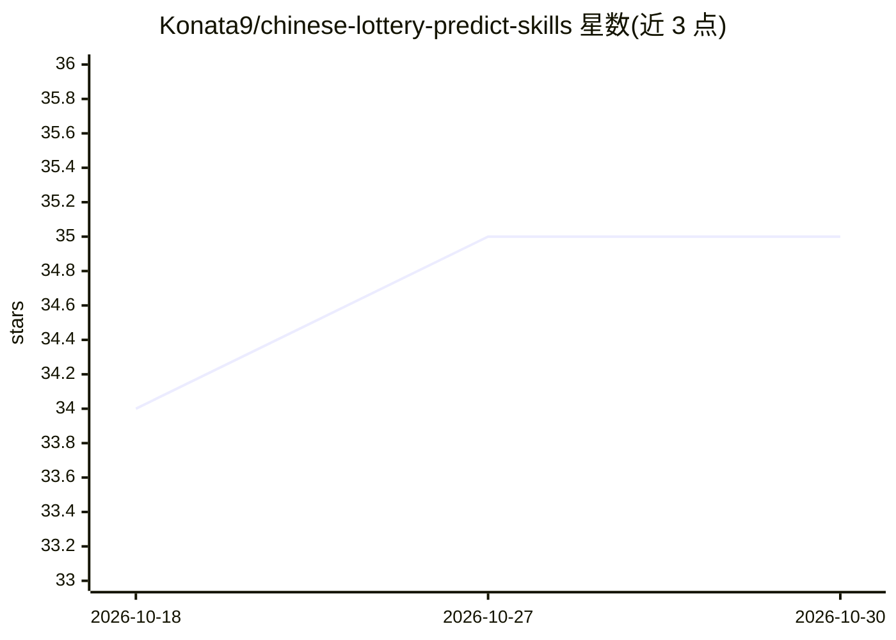

# Konata9/chinese-lottery-predict-skills

⭐ 35 · MIT · 推送 2026-07-28 · [GitHub](https://github.com/Konata9/chinese-lottery-predict-skills) · 个人维护 · 中文 README

**给 Agent 用户的双色球/大乐透号码推荐 Skill**

面向 AI Agent（如 Claude Code/OpenCode）的彩票号码推荐技能包：通过 SKILL.md 定义技能，Agent 执行时按 WebSearch/WebFetch/duckducksearch/tavily-search 优先级获取真实开奖数据，为双色球与大乐透生成仅供娱乐的号码推荐；无法获取真实数据时强制报错终止，不允许使用模拟数据。预算默认 10 元，按 2 元/组至少输出 5 组。通过 npx skills add 命令安装，仓库声明推荐内容不得表述为保证中奖。

## 筛选速览

| 维度 | 判定 | 备注 |
|---|---|---|
| AI 角色 | `ai-native` | 本体是模型或模型工具 |
| 许可风险 | `permissive` | MIT |
| 部署形态 | `library` | 以包/库形式分发 |
| 模型依赖 | — | README 未给出锁定关系 |
| 硬件要求 | — | 无带数字的原话,不猜 |
| 安装摩擦 | `low` | 无编译、无系统依赖或容器化 |
| 成熟度 | — | 结构信号不足 |

## 能力要点

- 覆盖双色球（SSQ）与大乐透（DLT）号码推荐
- 强制使用真实开奖数据，获取失败则报错终止，禁止模拟数据
- 数据获取按 WebSearch/WebFetch/duckducksearch/tavily-search 优先级
- 默认预算 10 元，按 2 元/组至少输出 5 组号码

## 适用场景

- 在 Claude Code 等 Agent 中安装后让 AI 生成彩票号码参考
- 按自定预算批量生成双色球或大乐透号码组合

## 场景标签

 · 领域:彩票号码预测/Agent 技能

## 证据(README 行号)

> L9: **建议配合 Claude Code/OpenCode 等 Agent 使用。**
> L13: - 面向 AI 的 skill 定义：SKILL.md

## 星数曲线

2026-10-18 34 → 2026-10-30 35（+1）

---
*卡片 v1 · prompt 1.4 · 生成 2026-10-25 · 置信度 high · 依据 README sha `f6e1e88caa73` · [字段定义](../../DATASET.md)*
