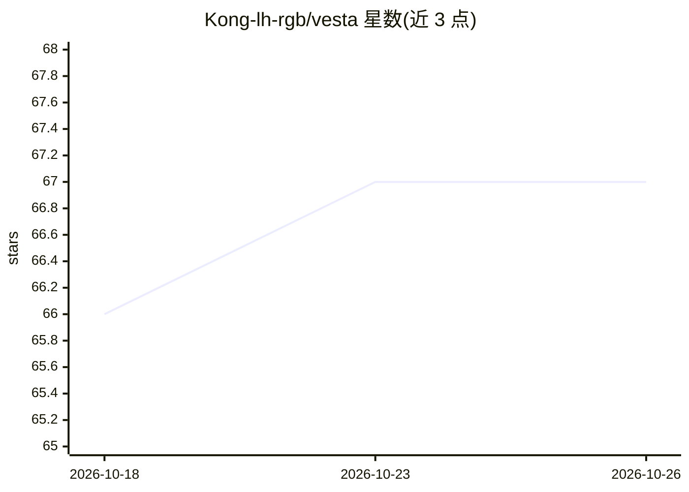

# Kong-lh-rgb/vesta

⭐ 67 · Python · MIT · 推送 2026-10-23 · [GitHub](https://github.com/Kong-lh-rgb/vesta) · 个人维护 · 中文 README

**面向长期工作的本地 AI Agent Harness：记忆、恢复与技能学习**

由 Python Host、Electron Desktop 和 macOS 原生 Computer Helper 组成的本地单用户 Agent 运行框架。提供长上下文管理、Task/Steps 跟踪、Run Checkpoint 恢复、本地与 MCP 工具系统（Shell 在 workspace 沙箱执行、MCP 进程经 macOS Seatbelt 隔离）、Core/Ordinary 两级长期记忆（FTS5+向量+RRF 混合召回）、从已完成 Task Trace 提炼 Skill 候选、定时自动化与异步审批。模型层通过统一 Adapter 接入 OpenAI、Qwen、DeepSeek、Anthropic。当前为源码运行的开发版本（0.1.0），无打包安装器；Computer Runtime 与安全后端仅限 macOS。

## 筛选速览

| 维度 | 判定 | 备注 |
|---|---|---|
| AI 角色 | `ai-ecosystem` | LLM/agent 周边工具 |
| 许可风险 | `permissive` | MIT |
| 部署形态 | `library` | 以包/库形式分发 |
| 模型依赖 | locked-api |  |
| 硬件要求 | — | 无带数字的原话,不猜 |
| 安装摩擦 | `low` | 无编译、无系统依赖或容器化 |
| 成熟度 | `idea` | |

## 能力要点

- Run 生命周期持久化与 Checkpoint 中断恢复
- Core/Ordinary 两级长期记忆，Hybrid 自动召回（FTS5+向量+RRF）
- 本地工具与 MCP 进程沙箱隔离（macOS Seatbelt），拒绝静默回退宿主机
- Skill Learning 从 Completed Task Trace 提炼候选经验，需人工确认

## 适用场景

- 让 Agent 在本地持续执行多步骤长任务并跟踪进度
- 中断后从 Checkpoint 恢复继续工作
- 通过 MCP 扩展接入外部工具并管控权限
- 把完成过的任务经验沉淀为可复用 Skill

## 场景标签

`Agent 框架` `Agent 记忆` · 领域:Agent 开发

## 证据(README 行号)

> L14: Vesta 是一个面向长期工作的本地 AI Agent Harness。它不只完成当前对话，还会管理
> L18: 当前项目由 Python Host、Electron Desktop 和 macOS 原生 Computer Helper 组成，模型层
> L70: - **Multi-Provider Models** — 统一适配 OpenAI、Qwen、DeepSeek 和 Anthropic API。

## 星数曲线

2026-10-18 66 → 2026-10-26 67（+1）

---
*卡片 v1 · prompt 1.4 · 生成 2026-10-24 · 置信度 mid · 依据 README sha `73636594b35b` · [字段定义](../../DATASET.md)*
