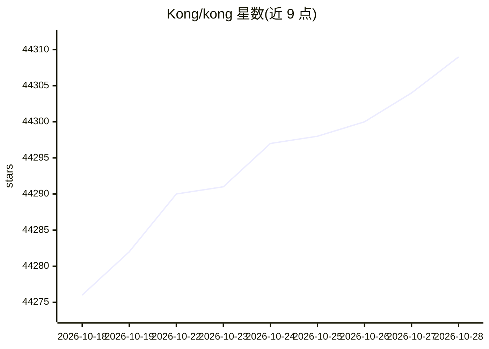

# Kong/kong

⭐ 44,314 · Lua · Apache-2.0 · 推送 2026-10-19 · [GitHub](https://github.com/Kong/kong) · [官网](https://konghq.com/install/) · 组织维护

**面向 API/LLM/MCP 流量的云原生网关**

Kong Gateway 是一个云原生、平台无关的网关，提供代理、路由、负载均衡、健康检查、认证等功能，作为微服务或常规 API 流量的中央编排层，并扩展至 LLM 与 MCP 流量。AI 能力包括多 LLM 提供商路由、语义安全、MCP 流量治理与可观测性、语义路由与缓存等。支持 Kubernetes Ingress Controller、数据库无关部署与混合部署（控制面/数据面分离），通过插件机制扩展功能，另有 Kong Konnect 云托管与商业订阅版本。

## 筛选速览

| 维度 | 判定 | 备注 |
|---|---|---|
| AI 角色 | `ai-ecosystem` | LLM/agent 周边工具 |
| 许可风险 | `permissive` | Apache-2.0 |
| 部署形态 | `None` |  |
| 模型依赖 | locked-api |  |
| 硬件要求 | — | 无带数字的原话,不猜 |
| 安装摩擦 | `low` | 无编译、无系统依赖或容器化 |
| 成熟度 | — | 结构信号不足 |

## 动量与使用信号

- 维护:`active` — 距上次 push 4.2 天,年发版 3,335 位贡献者
- 涨星:近 1 天 **+3**(自 20261016 起算)
- 平台:WEB · 协议:MCP

## 能力要点

- Universal LLM API 支持跨 OpenAI、Anthropic、Gemini、Bedrock 等多家提供商路由
- MCP 流量治理、安全与可观测性，并可从任意 RESTful API 自动生成 MCP
- 60+ AI 功能，含 AI 可观测性、语义安全与缓存、语义路由
- 通过官方 Kubernetes Ingress Controller 原生运行于 Kubernetes

## 适用场景

- 为组织内微服务与 API 提供统一的认证、限流与路由网关
- 统一接入和治理多个 LLM 提供商的流量
- 对 MCP 流量做安全与可观测性管控
- 在 Kubernetes 上以 Ingress Controller 方式管理入口流量

## 场景标签

`模型网关` · 领域:Agent 开发

## 证据(README 行号)

> L5: Kong or Kong Gateway is a cloud-native, platform-agnostic, scalable **API 𖧹 LLM 𖧹 MCP** Gateway distinguished for it
> L57: - Universal LLM API to route across multiple providers like OpenAI, Anthropic, GCP Gemini, AWS Bedrock, Azure AI, D

## 星数曲线

2026-10-18 44,276 → 2026-10-28 44,309（+33）

---
*卡片 v1 · prompt 1.4 · 生成 2026-10-18 · 置信度 high · 依据 README sha `63acf325c218` · [字段定义](../../DATASET.md)*
