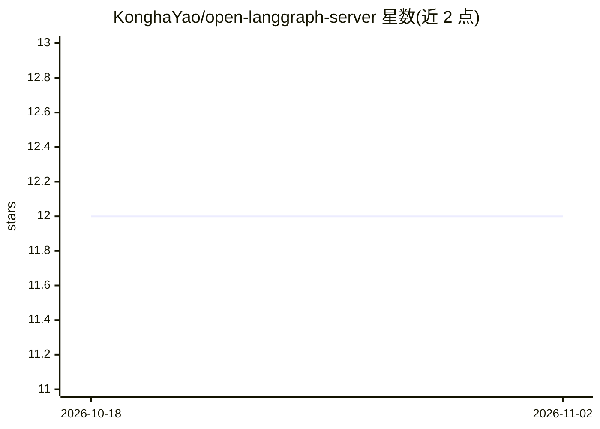

# KonghaYao/open-langgraph-server

⭐ 12 · TypeScript · 推送 2026-03-07 · [GitHub](https://github.com/KonghaYao/open-langgraph-server) · [官网](https://open-langgraph-server.agent-aura.top/) · 个人维护

**给 JS 开发者的 LangGraph 标准服务端点部署库**

为 LangGraph 提供标准 HTTP 端点的 TypeScript 库：通过 registerGraph 注册图，暴露 assistants/threads/runs 等 API（含流式运行），供 Next.js、Hono.js 及任何支持标准 fetch handler 的平台（Cloudflare Workers、Deno Deploy、Vercel Edge、Bun、Node.js）集成。核心实现基于 Web API（Request/Response），各框架适配器共享同一实现。支持 SQLite、PostgreSQL、Redis 及内存四种存储后端，Redis 启用时自动启用带 TTL 的消息队列；2.0+ 版本对应 LangGraph 1.0+。

## 筛选速览

| 维度 | 判定 | 备注 |
|---|---|---|
| AI 角色 | `ai-ecosystem` | LLM/agent 周边工具 |
| 许可风险 | `none` | — |
| 部署形态 | `library` | 以包/库形式分发 |
| 模型依赖 | — | README 未给出锁定关系 |
| 硬件要求 | — | 无带数字的原话,不猜 |
| 安装摩擦 | `low` | 无编译、无系统依赖或容器化 |
| 成熟度 | — | 结构信号不足 |

## 能力要点

- 标准 fetch 核心实现，7 类平台适配器共享同一行为
- SQLite/PostgreSQL/Redis/内存四种存储后端，配置按优先级自动选择
- Redis stream 消息队列，自动 TTL 管理（300 秒）
- 提供 Assistants/Threads/Runs 完整 REST 端点含流式运行

## 适用场景

- 把 LangGraph agent 以标准端点嵌入 Next.js 或 Hono 应用
- 在 Cloudflare Workers / Deno Deploy 等边缘平台运行 LangGraph 服务
- 按规模选择 SQLite/PostgreSQL/Redis 持久化 graph 状态与会话数据

## 场景标签

 · 领域:LLM 基础设施/agent 服务化

## 证据(README 行号)

> L3: Open LangGraph Server is a library that provides a standard LangGraph endpoint for integrating into various framewor
> L20: - **Multiple Storage Backends**: Support for SQLite, PostgreSQL, Redis, and in-memory storage

## 星数曲线

2026-10-18 12 → 2026-11-02 12（+0）

---
*卡片 v1 · prompt 1.4 · 生成 2026-11-01 · 置信度 high · 依据 README sha `ae8249efb011` · [字段定义](../../DATASET.md)*
