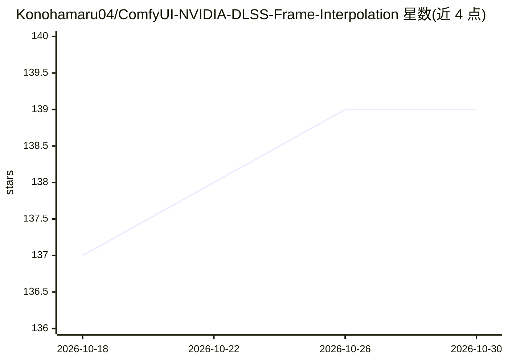

# Konohamaru04/ComfyUI-NVIDIA-DLSS-Frame-Interpolation

⭐ 139 · Python · MIT · 推送 2026-09-17 · [GitHub](https://github.com/Konohamaru04/ComfyUI-NVIDIA-DLSS-Frame-Interpolation) · 个人维护

**ComfyUI 自定义节点：DLSS 5 视频/图像超分与插帧**

为 ComfyUI 提供三个 NVIDIA DLSS 处理节点：帧插值（提升视频帧率至最高 120 FPS）、视频超分（1x DLAA 至 3x，最大 7680×4320）、图像/图像批次超分（内存中直接返回 IMAGE 张量）。捆绑 DLSS 运行时 DLL 与原生 worker，无模型下载与网络请求；需要 NVIDIA RTX GPU、NVIDIA 驱动、FFmpeg/FFprobe，Windows 原生支持，Linux 需经 Wine（实验性）运行 Windows worker。输出为临时视频，需连接 Save Video 持久化。

## 筛选速览

| 维度 | 判定 | 备注 |
|---|---|---|
| AI 角色 | `ai-native` | 本体是模型或模型工具 |
| 许可风险 | `permissive` | MIT |
| 部署形态 | `desktop` | 安装包/桌面程序 |
| 模型依赖 | — | README 未给出锁定关系 |
| 硬件要求 | — | 无带数字的原话,不猜 |
| 安装摩擦 | `medium` | 含编译或系统依赖之一 |
| 成熟度 | `idea` | |

## 能力要点

- 三个节点：帧插值、视频超分、图像超分，使用 ComfyUI 原生 VIDEO/IMAGE 类型
- 捆绑 DLSS 运行时，无模型下载、无遥测、无网络请求
- 分辨率模式覆盖 1x DLAA 至 3x Ultra Performance，最大 7680×4320
- 输出 report_json 诊断，可校验神经超分是否实际激活（含 fallback 判定）

## 适用场景

- 在 ComfyUI 工作流中对视频做 DLSS 超分与帧率提升
- 提升图像或图像批次的分辨率
- 在生成视频后插帧到 60/120 FPS 输出

## 场景标签

`图像视频处理` · 领域:感知与多模态

## 证据(README 行号)

> L5: - **NVIDIA DLSS Frame Interpolation** — increases video frame rate.
> L6: - **NVIDIA DLSS Video Upscale** — increases video resolution.
> L7: - **NVIDIA DLSS Image Upscale** — increases image or image-batch resolution.
> L83: - A compatible NVIDIA RTX GPU

## 星数曲线

2026-10-18 137 → 2026-10-30 139（+2）

---
*卡片 v1 · prompt 1.4 · 生成 2026-10-22 · 置信度 high · 依据 README sha `08a9552d8a83` · [字段定义](../../DATASET.md)*
