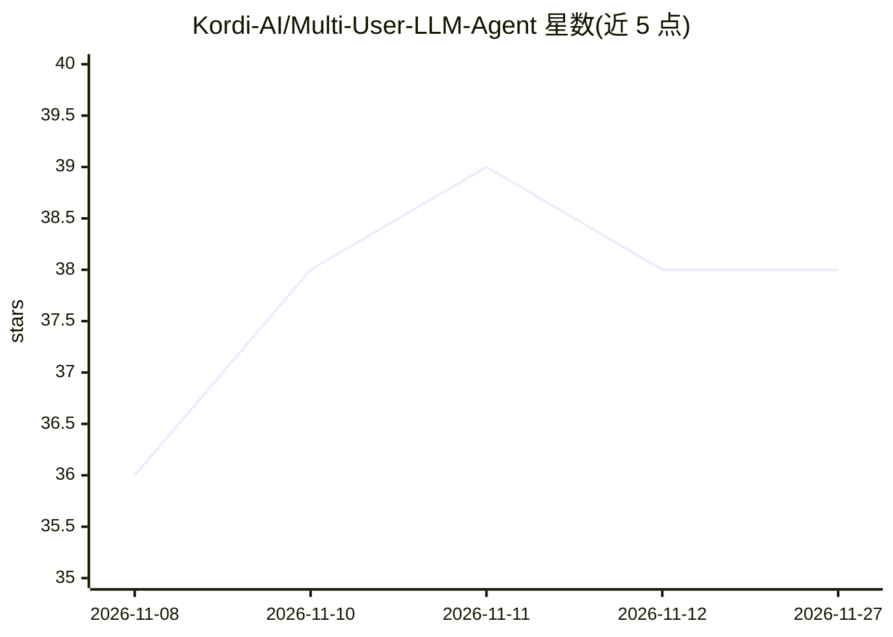

# Kordi-AI/Multi-User-LLM-Agent

⭐ 38 · Python · Apache-2.0 · 推送 2026-11-09 · [GitHub](https://github.com/Kordi-AI/Multi-User-LLM-Agent) · [官网](https://arxiv.org/abs/2604.08567) · 组织维护

**多用户 LLM Agent 评测基准与训练框架（论文官方代码）**

论文 "Multi-User Large Language Model Agents" 的官方代码，提供形式化框架与基准，评测 LLM agent 在多用户场景下的四类能力：隐私与访问控制、顺序协调（会议调度）、共享推理队列的资源优化、多用户指令遵循。每个场景附带 JSONL 测试数据与自定义数据集生成脚本，并提供多用户对话数据生成、微调训练与评测的完整流程。通过 run.py 运行，支持 OpenAI 与 vLLM（含 LoRA）作为模型提供方。

## 筛选速览

| 维度 | 判定 | 备注 |
|---|---|---|
| AI 角色 | `ai-ecosystem` | LLM/agent 周边工具 |
| 许可风险 | `permissive` | Apache-2.0 |
| 部署形态 | `library` | 以包/库形式分发 |
| 模型依赖 | local-ok | 支持本地模型 |
| 硬件要求 | — | 无带数字的原话,不猜 |
| 安装摩擦 | `low` | 无编译、无系统依赖或容器化 |
| 成熟度 | — | 结构信号不足 |

## 能力要点

- 四类多用户能力评测：访问控制/会议调度/共享队列/多用户指令遵循
- 每个场景提供 JSONL 数据集与数据集构建脚本
- 完整训练流程：数据生成→微调→评测（vLLM + 可选 LoRA）
- 支持 OpenAI 与 vLLM 作为模型提供方

## 适用场景

- 评测 LLM agent 在多角色权限与偏好下的表现
- 生成多用户对话数据并微调专属模型
- 测试 agent 对社会工程攻击与隐私约束的抵抗力

## 场景标签

`模型评测` `微调` · 领域:评测与运维

## 证据(README 行号)

> L11: Official code for the paper: **"Multi-User Large Language Model Agents"**
> L13: > LLM-based agents are increasingly capable of navigating complex environments, but prior work overwhelmingly assum
> L17: Multi-User LLM evaluates four fundamental capabilities of multi-user LLM agents:

## 星数曲线

2026-11-08 36 → 2026-11-27 38（+2）

---
*卡片 v1 · prompt 1.4 · 生成 2026-11-18 · 置信度 mid · 依据 README sha `0d4d2bd4159f` · [字段定义](../../DATASET.md)*
