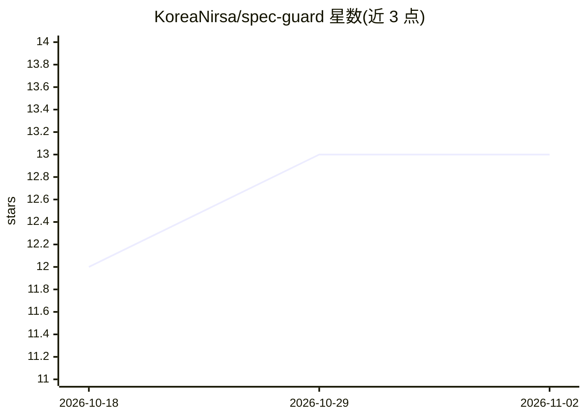

# KoreaNirsa/spec-guard

⭐ 13 · Python · Apache-2.0 · 推送 2026-08-20 · [GitHub](https://github.com/KoreaNirsa/spec-guard) · 个人维护 · 中文 README

**AI 编码前置的规格校验 CLI：在 AI 写码前拦截弱规格**

面向 AI 辅助开发的 Validation-First Workflow（VFW）命令行工具：把产品规格（spec.md）转成经过评审、可测试、可交付实现的规格包，实现前运行启发式 SpecGuard Review 阻断 Critical 发现，实现后可将 GitHub PR 与已批准规格包比对并留评。实现由外部 Codex、Claude Code 等编码 agent 完成，本工具不含码生成。附带 Codex 应用插件（调用既有 CLI）、示例规格包与 220 案例的 gate-only 基准。韩文支持限于确定性低模式，非完整本地化。

## 筛选速览

| 维度 | 判定 | 备注 |
|---|---|---|
| AI 角色 | `ai-ecosystem` | LLM/agent 周边工具 |
| 许可风险 | `permissive` | Apache-2.0 |
| 部署形态 | `library` | 以包/库形式分发 |
| 模型依赖 | — | README 未给出锁定关系 |
| 硬件要求 | — | 无带数字的原话,不猜 |
| 安装摩擦 | `low` | 无编译、无系统依赖或容器化 |
| 成熟度 | — | 结构信号不足 |

## 能力要点

- 实现前 SpecGuard Review 阻断 Critical 发现，实现后 PR Review 比对规格包
- Codex 应用插件：运行 specguard 命令并读取结构化评审产物
- 默认低模式为快速启发式评审，支持 --no-llm 无 LLM 运行
- 嵌套 specs/<feature>/spec.md 包发现与确定性单候选选择

## 适用场景

- 在把规格交给 AI 编码 agent 前验证规格是否实现就绪
- 让 PR 评审对照已批准规格发现实现漂移
- 配合 Codex CLI 在应用内运行规格校验流程

## 场景标签

`代码审查` · 领域:编码与开发

## 证据(README 行号)

> L7: **SpecGuard blocks weak specs before AI coding agents turn them into defective code.**
> L12: It is not a prompt-to-code generator. SpecGuard helps you prepare an approved spec package before an external Codex
> L47: SpecGuard owns the validation path through Implementation Handoff. The user or an external coding agent owns implem

## 星数曲线

2026-10-18 12 → 2026-11-02 13（+1）

---
*卡片 v1 · prompt 1.4 · 生成 2026-10-31 · 置信度 high · 依据 README sha `2e881aae8c4b` · [字段定义](../../DATASET.md)*
