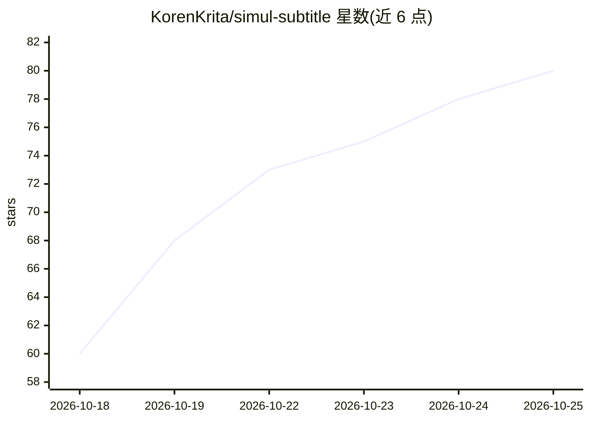

# KorenKrita/simul-subtitle

⭐ 80 · Kotlin · MIT · 推送 2026-10-21 · [GitHub](https://github.com/KorenKrita/simul-subtitle) · 个人维护 · 中文 README

**日/英语视频与直播的实时同传悬浮字幕应用（三端）**

面向观众用户的实时同传字幕工具，支持 Android、macOS、Windows 三端：手机端内录目标 App 播放音频，电脑端监听系统音频输出，悬浮窗覆盖在任意播放器或直播软件上方。语音识别（ReazonSpeech + Silero VAD，约 78 MB 离线模型）完全在本地完成，音频不上传；翻译通过 BYOK 方式调用用户自备的 OpenAI 兼容 LLM 接口（如 DeepSeek、通义千问、OpenRouter），仅发送识别后的文本。支持任意目标语言、场景背景与术语表，识别原声语言目前限日语和英语。

## 筛选速览

| 维度 | 判定 | 备注 |
|---|---|---|
| AI 角色 | `ai-native` | 本体是模型或模型工具 |
| 许可风险 | `permissive` | MIT |
| 部署形态 | `desktop` | 安装包/桌面程序 |
| 模型依赖 | — | README 未给出锁定关系 |
| 硬件要求 | — | 无带数字的原话,不猜 |
| 安装摩擦 | `low` | 无编译、无系统依赖或容器化 |
| 成熟度 | — | 结构信号不足 |

## 能力要点

- ReazonSpeech + Silero VAD 离线语音识别，音频不离开设备
- BYOK 接入任意 OpenAI 兼容接口，多套配置可切换，自动探测关闭思考模式
- 不挑播放器的全局悬浮字幕，B 站/YouTube/Twitch/本地播放器均可用
- 场景化背景说明与术语表，可让 LLM 一键生成常用术语

## 适用场景

- 看日语或英语视频/直播时获得实时翻译悬浮字幕
- 为 VTuber 直播配置带背景说明与固定译名的字幕
- 在本地离线完成语音识别、仅文本送 LLM 翻译的隐私需求场景

## 场景标签

`语音识别` · 领域:感知与多模态

## 证据(README 行号)

> L30: - **语音识别完全在本地完成**：App 内置 ReazonSpeech 与 Silero VAD 离线模型（约 78 MB），开箱即用、无需额外下载，**音频永远不会离开你的设备**。
> L31: - **自备 LLM 接口（BYOK）**：填入任意 OpenAI 兼容接口的地址、模型 ID 与 API Key（如 DeepSeek、通义千问、OpenRouter 等），按自身实际用量向服务商付费，可保存多套配置随时切换；首

## 星数曲线

2026-10-18 60 → 2026-10-25 80（+20）

---
*卡片 v1 · prompt 1.4 · 生成 2026-10-24 · 置信度 high · 依据 README sha `553e44d1455f` · [字段定义](../../DATASET.md)*
