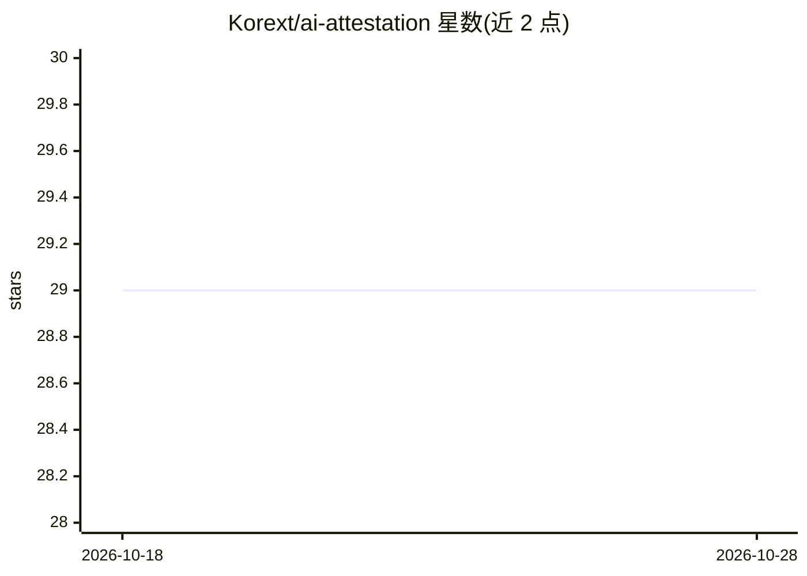

# Korext/ai-attestation

⭐ 29 · JavaScript · Apache-2.0 · 推送 2026-05-30 · [GitHub](https://github.com/Korext/ai-attestation) · [官网](https://oss.korext.com/ai-attestation) · 组织维护

**追踪仓库中 AI 生成代码的开放标准与 CLI 工具**

提供机器可读的 YAML 证明文件（.ai-attestation.yaml）记录仓库中使用了哪些 AI 编码工具、生成代码比例及治理扫描状态。通过扫描 git 历史（co-author 尾注、提交信息模式、元数据头、git 配置）识别 19 种 AI 编码工具，并以 post-commit 钩子自动更新。仅处理 git 元数据，不读取源码，本地运行无网络调用。规格以 CC0 发布，代码 Apache-2.0。面向企业、开源维护者与合规团队。

## 筛选速览

| 维度 | 判定 | 备注 |
|---|---|---|
| AI 角色 | `ai-ecosystem` | LLM/agent 周边工具 |
| 许可风险 | `permissive` | Apache-2.0 |
| 部署形态 | `library` | 以包/库形式分发 |
| 模型依赖 | — | README 未给出锁定关系 |
| 硬件要求 | — | 无带数字的原话,不猜 |
| 安装摩擦 | `low` | 无编译、无系统依赖或容器化 |
| 成熟度 | — | 结构信号不足 |

## 能力要点

- 识别 19 种 AI 编码工具（Copilot/Cursor/Claude Code 等）
- 基于 co-author 尾注等 4 类公开信号检测
- post-commit 钩子自动更新证明文件
- GitHub Action 在 CI 中执行策略（失败/治理分数/人工审查要求）

## 适用场景

- 回答'这个代码库有多少是 AI 写的'
- 在 CI 中强制执行 AI 代码治理策略
- 开源项目声明 AI 生成代码的来源

## 场景标签

 · 领域:开发工具/软件合规

## 证据(README 行号)

> L10: AI Attestation is a machine readable YAML file placed in your repository root
> L16: Enterprises, open source maintainers, and compliance teams increasingly need
> L33: 1. Scan your git history for AI tool signatures

## 星数曲线

2026-10-18 29 → 2026-10-28 29（+0）

---
*卡片 v1 · prompt 1.4 · 生成 2026-10-26 · 置信度 high · 依据 README sha `7ba585925806` · [字段定义](../../DATASET.md)*
