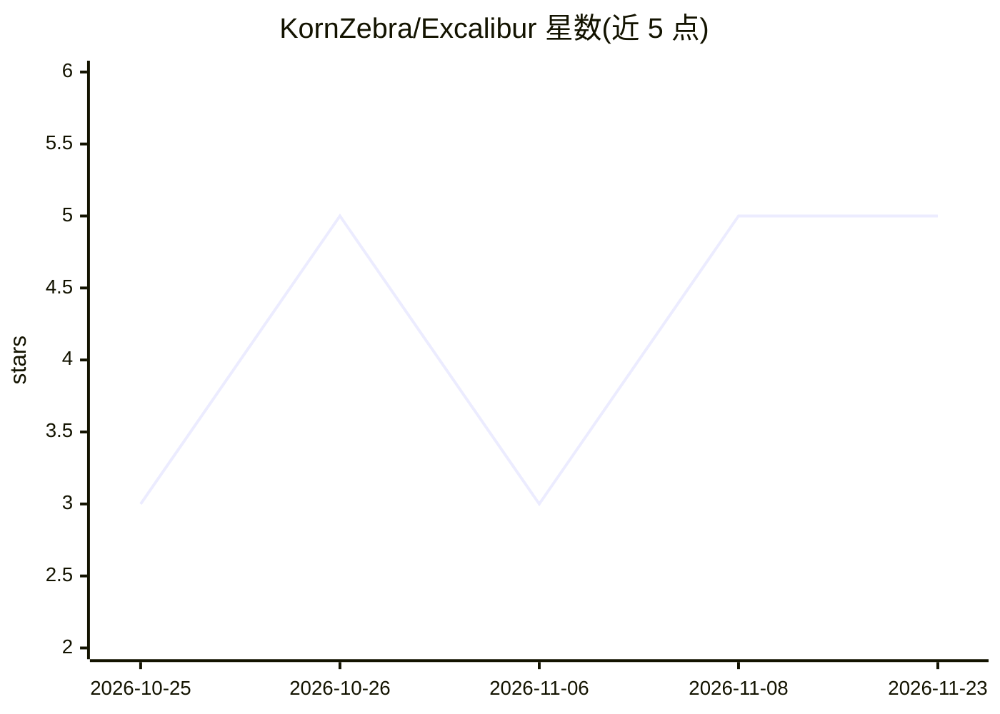

# KornZebra/Excalibur

⭐ 5 · Python · MIT · 推送 2026-10-23 · [GitHub](https://github.com/KornZebra/Excalibur) · 个人维护 · 中文 README

**面向 CTF 选手的自主解题智能体平台，全流程自动闭环**

用 Python + FastAPI 构建的 CTF 自主解题智能体平台：输入题目描述与附件，代理按 ReAct 循环自主完成理题、侦察、分析、利用尝试、Flag 提取与解题报告。机制上提供外置调度回路、状态账本与黑板、双阶段收尾、三模式 HITL 命令拦截审查、全链路事件流；支持单代理与按 Web/Pwn/Crypto 等方向派发子代理的多代理模式，以及竞赛题目池同步。运行需 Python ≥ 3.11 与任意 OpenAI 兼容模型密钥；仅限 CTF、自建靶场或获授权目标。

## 筛选速览

| 维度 | 判定 | 备注 |
|---|---|---|
| AI 角色 | `ai-native` | 本体是模型或模型工具 |
| 许可风险 | `permissive` | MIT |
| 部署形态 | `self-host` | docker 或自建部署 |
| 模型依赖 | — | README 未给出锁定关系 |
| 硬件要求 | — | 无带数字的原话,不猜 |
| 安装摩擦 | `low` | 无编译、无系统依赖或容器化 |
| 成熟度 | — | 结构信号不足 |

## 能力要点

- ReAct 自主解题循环，迭代上限、工具超时与并发均可配置
- 多代理编排：按 Web/Pwn/Crypto/Reverse/Misc/Recon 方向派发子代理
- Idea/Memory 双状态账本与跨会话黑板共享
- 三模式 HITL 审查：命令执行前拦截，超时 fail-closed

## 适用场景

- CTF 竞赛中让代理自主解 Web/Pwn/Crypto 等方向题目
- 自建靶场里自动化安全解题训练与复盘
- 竞赛现场多题并发管理与 Flag 看板追踪

## 场景标签

`网络安全` `多智能体` · 领域:Agent 开发

## 证据(README 行号)

> L32: **Excalibur（湖中剑）** 是一个用 Python 构建的 CTF 自主解题智能体平台。输入题目描述与附件，代理会自主完成
> L35: 它不是"给模型套一层工具调用"的壳，而是一套围绕 LLM 搭建的**控制系统**：外置调度回路、状态账本、
> L43: |🕸️ **多代理编排**|单代理 / 多代理（deep）双模式；按 Web、Pwn、Crypto、Reverse、Misc、Recon 方向派发子代理|

## 星数曲线

2026-10-25 3 → 2026-11-23 5（+2）

---
*卡片 v1 · prompt 1.4 · 生成 2026-11-21 · 置信度 high · 依据 README sha `bc82d1dfa2fb` · [字段定义](../../DATASET.md)*
