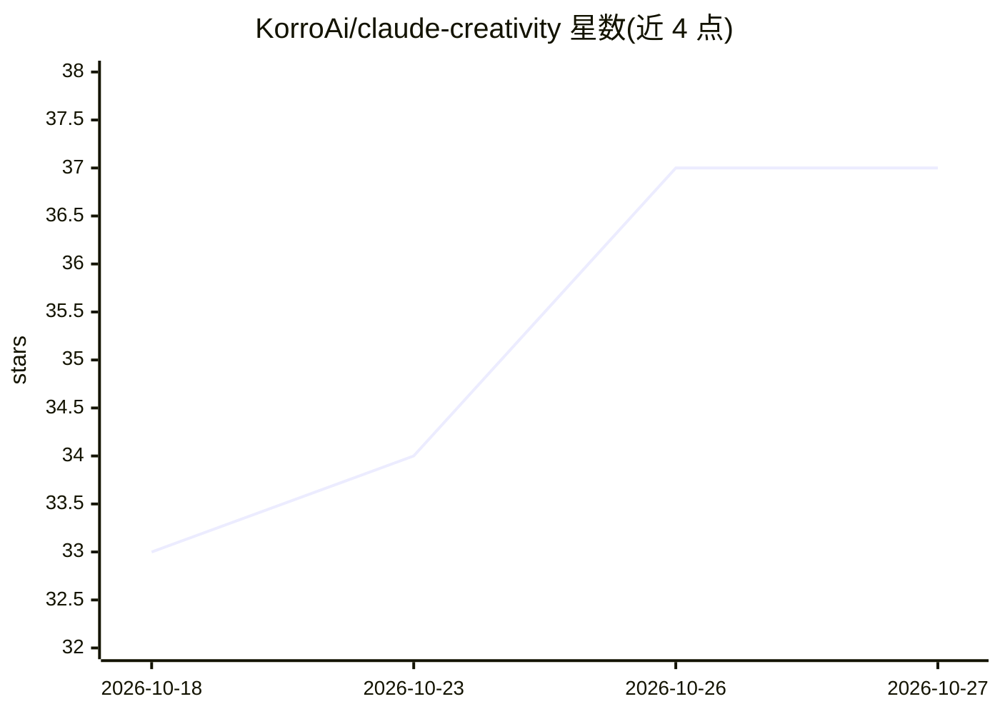

# KorroAi/claude-creativity

⭐ 37 · TeX · MIT · 推送 2026-10-10 · [GitHub](https://github.com/KorroAi/claude-creativity) · [官网](https://korrocorp.com) · 个人维护

**给 Claude Code 加 15 种创意技法的头脑风暴技能包**

一个 Claude Code 技能（SKILL.md 格式），在对话检测到创意场景（头脑风暴、命名、架构、卡壳）时自动激活：从 15 种源自创意研究文献的技法（横向思维、第一性原理、反转、强制类比、斜向策略等）中按问题类型选用，生成通过三重质量过滤的想法，以 4 种输出风格（编号列表/详细/扑克牌/融合模式）附加在回答末尾。强度滑块 0.1-1.0 控制想法数量与技法组合。安装方式为复制文件夹到 skills 目录，无依赖、无配置、无 API key。

## 筛选速览

| 维度 | 判定 | 备注 |
|---|---|---|
| AI 角色 | `ai-ecosystem` | LLM/agent 周边工具 |
| 许可风险 | `permissive` | MIT |
| 部署形态 | `None` |  |
| 模型依赖 | locked-api |  |
| 硬件要求 | — | 无带数字的原话,不猜 |
| 安装摩擦 | `low` | 无编译、无系统依赖或容器化 |
| 成熟度 | — | 结构信号不足 |

## 能力要点

- 15 种技法按问题类型自动匹配，高强度时组合 2-3 种
- 三重质量过滤：用户自己能否想到/是否只有意外性/是否为已知方案的温和变体
- 强度等级 0.1-1.0 控制想法数量（2-3 至 5-7+）
- 无依赖、无配置、无 API key，复制到 skills 目录即生效

## 适用场景

- 头脑风暴时在 Claude 回答末尾获得额外创意想法
- 为产品或项目命名寻找非常规角度
- 方案卡壳时用反转、挑衅、随机刺激等技法破局

## 场景标签

`提示工程` · 领域:Agent 开发

## 证据(README 行号)

> L7: Claude Creativity is a skill for Claude Code that transforms Claude from a helpful assistant into a true creative pa
> L53: Drop the folder into your Claude Code skills directory and restart Claude Code.

## 星数曲线

2026-10-18 33 → 2026-10-27 37（+4）

---
*卡片 v1 · prompt 1.4 · 生成 2026-10-25 · 置信度 high · 依据 README sha `6cd91310a393` · [字段定义](../../DATASET.md)*
