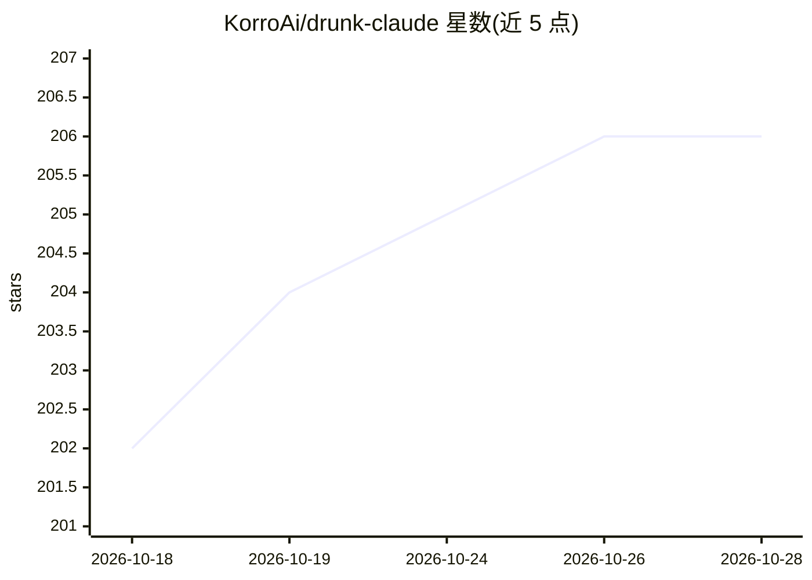

# KorroAi/drunk-claude

⭐ 207 · TeX · MIT · 推送 2026-10-10 · [GitHub](https://github.com/KorroAi/drunk-claude) · [官网](https://korrocorp.com) · 组织维护

**Claude Code 头脑风暴技能：以"微醺"人设注入大胆创意**

面向 Claude Code 的 SKILL.md 格式技能：安装到 ~/.claude/skills/ 后以 /drunk-claude 命令调用，在头脑风暴等创意场景中切换为降低自我审查的"微醺天才"人设。提供 0.1-1.0 强度滑杆、5 种情绪（--mood）与 5 种饮品类型（--drink，仅改变表情符号），循环使用 8 种创意技法（Hold My Beer、3AM Diner 等），想法需通过三重质量门槛才输出；生产调试、事实性问题等场景保持安静不介入。

## 筛选速览

| 维度 | 判定 | 备注 |
|---|---|---|
| AI 角色 | `ai-ecosystem` | LLM/agent 周边工具 |
| 许可风险 | `permissive` | MIT |
| 部署形态 | `None` |  |
| 模型依赖 | — | README 未给出锁定关系 |
| 硬件要求 | — | 无带数字的原话,不猜 |
| 安装摩擦 | `low` | 无编译、无系统依赖或容器化 |
| 成熟度 | — | 结构信号不足 |

## 能力要点

- 0.1（Tipsy）到 1.0（Blackout）强度滑杆与 5 种情绪模式
- 8 种创意技法按上下文循环选用
- 想法须通过三重质量门槛（有趣+有洞察+非普通想法）
- 生产调试、事实性提问等场景自动不介入

## 适用场景

- 头脑风暴时打破安全但无聊的想法循环
- 方案卡壳时换个视角获得非常规创意
- 给设计、命名、品牌等创意任务换个输出风格

## 场景标签

`提示工程` · 领域:Agent 开发

## 证据(README 行号)

> L7: Drunk Claude is a Claude Code skill that turns your friendly neighborhood AI into that friend at the party everyone 
> L60: Drop the `drunk-claude` folder into `~/.claude/skills/` and restart Claude Code. That's it.

## 星数曲线

2026-10-18 202 → 2026-10-28 206（+4）

---
*卡片 v1 · prompt 1.4 · 生成 2026-10-22 · 置信度 high · 依据 README sha `1f0f440d2cc2` · [字段定义](../../DATASET.md)*
