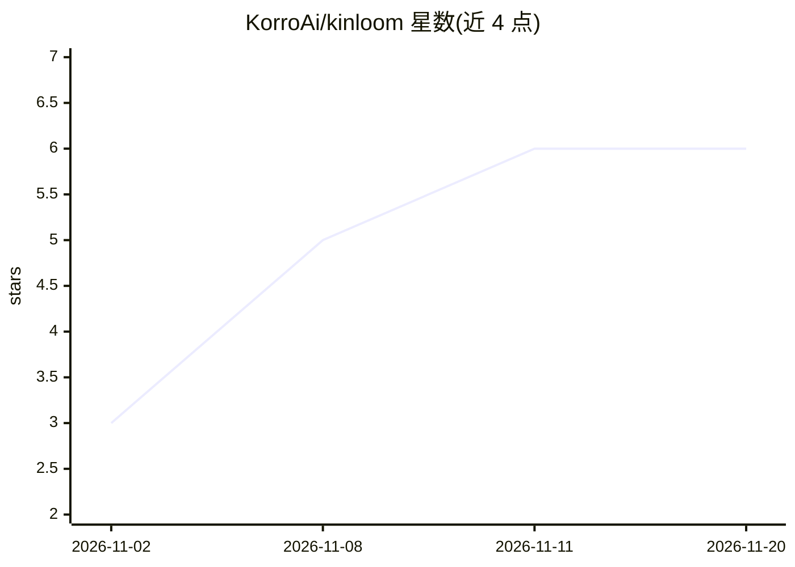

# KorroAi/kinloom

⭐ 6 · Python · MIT · 推送 2026-10-30 · [GitHub](https://github.com/KorroAi/kinloom) · [官网](https://korrocorp.com/devlog/kinloom) · 组织维护

**给游戏开发者提供可接入任意引擎与模型的 AI NPC/内容生成 SDK**

Kinloom 是面向游戏开发的 AI 集成工具：提供 decide/create/chat/act 等调用，让角色可对话、逐帧决策、生成内容并调用游戏自身函数；开发者以示例描述期望答案，模型输出经示例校验后才交给游戏。每次调用都有离线回退答案，无 key、无网络或模型缓慢时游戏仍可运行。以 Python CLI（uv/pip 安装）加各引擎单文件客户端分发，支持 Unity、Godot、Web、Rust、C++、Java、Lua 等平台，通过 key、relay 或离线三种模式调用模型。

## 筛选速览

| 维度 | 判定 | 备注 |
|---|---|---|
| AI 角色 | `ai-ecosystem` | LLM/agent 周边工具 |
| 许可风险 | `permissive` | MIT |
| 部署形态 | `library` | 以包/库形式分发 |
| 模型依赖 | local-ok | 支持本地模型 |
| 硬件要求 | — | 无带数字的原话,不猜 |
| 安装摩擦 | `medium` | 含编译或系统依赖之一 |
| 成熟度 | — | 结构信号不足 |

## 能力要点

- 单文件客户端覆盖 C#/GDScript/TS/C++17/Rust/Java/Lua/Python 多引擎
- 示例校验机制：模型输出须匹配示例形状，未知工具被拒绝
- 离线回退：无 key/无网络/慢模型时以示例作为答案，游戏不中断
- relay 部署模式：key 不下发玩家，含玩家 token、限流与消费上限

## 适用场景

- 给游戏 NPC 添加可自由对话的角色并接入记忆与好感度
- 用一句话生成关卡、房间或道具等内容
- 为老游戏或无 mod API 的游戏通过 hooks 做个人用途 mod
- 上线带 AI 功能的游戏时用 relay 保护 key 并控制开销

## 场景标签

`聊天机器人` · 领域:对话与助手

## 证据(README 行号)

> L16: Kinloom adds AI to your game: characters players can really talk to, decisions made every frame, content generated
> L91:  C#, GDScript, TypeScript/JavaScript, C++17, Rust, Java, Lua and Python, with the same calls and the same behavior.
> L92: - **Any model.** Claude, OpenAI, DeepSeek, OpenRouter, Groq, Gemini, Mistral, any OpenAI-compatible endpoint,

## 星数曲线

2026-11-02 3 → 2026-11-20 6（+3）

---
*卡片 v1 · prompt 1.4 · 生成 2026-11-20 · 置信度 high · 依据 README sha `9da34ba7f6d1` · [字段定义](../../DATASET.md)*
