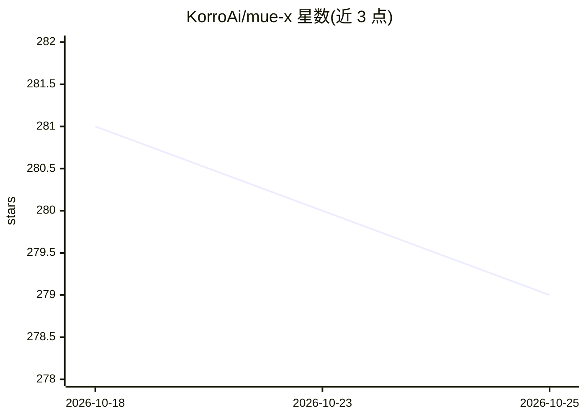

# KorroAi/mue-x

⭐ 279 · Python · MIT · 推送 2026-10-10 · [GitHub](https://github.com/KorroAi/mue-x) · [官网](https://korrocorp.com) · 组织维护

**自我改写源码的自进化 AI agent，跨平台 CLI 运行**

MUE-X 是一个在运行中持续改写自身 Python 源码的 agent：扫描自身 60+ 模块（基因），用 6 种 AST 级变异策略（repair/optimize/explore/exploit/innovate/prune）生成并通过 ast.parse 校验后应用变更，失败回滚。配套机制包括：7 种自主驱动信号、5 层自我保护（备份/导入测试/内核封印等）、SQLite FTS5 六层持久记忆、PAD 情绪模型调节策略选择，以及通过 GitHub API 克隆仓库提取代码模式的吸收功能。以 Claude Code 技能（/mue 命令）或独立 CLI（python -m mue）运行，需 Python 3.11+。

## 筛选速览

| 维度 | 判定 | 备注 |
|---|---|---|
| AI 角色 | `ai-native` | 本体是模型或模型工具 |
| 许可风险 | `permissive` | MIT |
| 部署形态 | `None` |  |
| 模型依赖 | — | README 未给出锁定关系 |
| 硬件要求 | — | 无带数字的原话,不猜 |
| 安装摩擦 | `low` | 无编译、无系统依赖或容器化 |
| 成熟度 | — | 结构信号不足 |

## 能力要点

- 6 种 AST 级变异策略实时改写自身源码，含校验与回滚
- 通过 GitHub API 自动克隆仓库、SHA256 去重后吸收代码模式
- SQLite FTS5 六层持久记忆结构与 7 种自主驱动信号
- PAD 情绪模型（8 种情绪）影响变异策略选择

## 适用场景

- 观察/研究一个持续自我修改代码的 agent 的运行过程
- 让 agent 根据对话领域自动吸收 GitHub 代码模式
- 在 Claude Code 或任意终端中以 CLI 运行自进化 agent

## 场景标签

`编码 Agent` · 领域:编码与开发

## 证据(README 行号)

> L12: **This agent opens its own `.py` files and rewrites them in real-time while you watch.** Not a metaphor. Not a wrap
> L29: Type `/mue` (or `python -m mue` on any platform) and the agent begins a continuous observe → absorb → mutate → veri
> L85: python -m mue              # Interactive REPL

## 星数曲线

2026-10-18 281 → 2026-10-25 279（-2）

---
*卡片 v1 · prompt 1.4 · 生成 2026-10-22 · 置信度 high · 依据 README sha `a840447163c8` · [字段定义](../../DATASET.md)*
