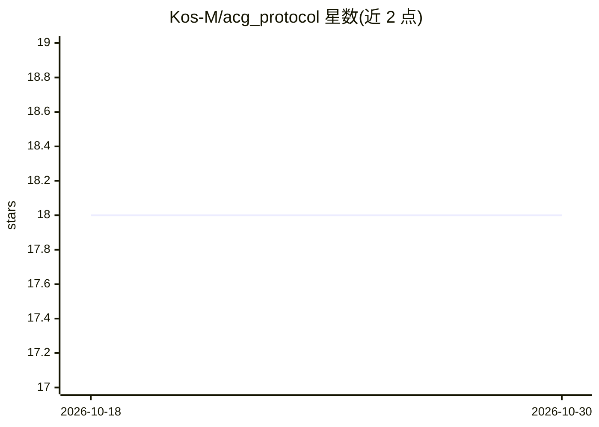

# Kos-M/acg_protocol

⭐ 18 · Python · 推送 2026-10-20 · [GitHub](https://github.com/Kos-M/acg_protocol) · 个人维护

**面向 RAG/LLM 输出的双层可审计协议：事实溯源与推理核验**

ACG 是一个两层协议标准，用于在 RAG 或 LLM 系统的输出管线中提供可机器审计的事实与推理校验。UGVP 层通过声明标记（C_n）、源哈希（SHI）与审计注册表（VAR）将每条事实声明定位到源文档并由独立验证代理核验；RSVP 层校验推理关系（CAUSAL/INFERENCE/SUMMARY/COMPARISON）是否由已验证前提与显式逻辑模型支持，失败项被标记或移除。面向法律、医疗、科研等高可信场景的开发者；当前实现基于 Strands-agents、MongoDB 与 Gemini 2.5 Flash，基准测试标注为 WIP，且实施需要修改生成代理并开发独立验证代理，引入额外算力、存储与延迟成本。

## 筛选速览

| 维度 | 判定 | 备注 |
|---|---|---|
| AI 角色 | `ai-ecosystem` | LLM/agent 周边工具 |
| 许可风险 | `none` | — |
| 部署形态 | `None` |  |
| 模型依赖 | — | README 未给出锁定关系 |
| 硬件要求 | — | 无带数字的原话,不猜 |
| 安装摩擦 | `low` | 无编译、无系统依赖或容器化 |
| 成熟度 | `idea` | |

## 能力要点

- UGVP 层：声明标记 + 源哈希 + VAR 注册表实现原子事实溯源
- RSVP 层：按关系类型核验推理是否由已验证前提支撑
- 两阶段独立审计：未验证声明被移除、逻辑不足被标记
- 实现栈为 Strands-agents + MongoDB + Gemini 2.5 Flash

## 适用场景

- 法律、医疗、金融等高风险内容生成中拦截无源声明
- 事实核查与自动新闻生成的产出审计
- 决策支持系统提供可解释的推理审计轨迹

## 场景标签

`RAG` `LLM 可观测性` · 领域:评测与运维

## 证据(README 行号)

> L50: ACG is designed to be integrated into the output pipeline of any RAG or LLM-based system where veracity and auditab
> L61: 1. **Agent Integration:** The AI generation agent is modified to embed $\text{C}_n$ markers for atomic facts and $\
> L63: 3. **Independent Verification:** A separate, independent Verifier Agent processes the ACG-marked output and the VAR

## 星数曲线

2026-10-18 18 → 2026-10-30 18（+0）

---
*卡片 v1 · prompt 1.4 · 生成 2026-10-29 · 置信度 mid · 依据 README sha `0dbd8a454076` · [字段定义](../../DATASET.md)*
