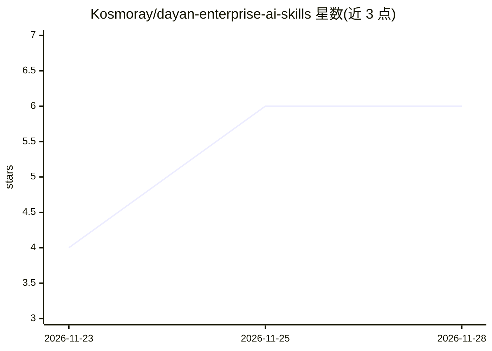

# Kosmoray/dayan-enterprise-ai-skills

⭐ 6 · Python · NOASSERTION · 推送 2026-11-23 · [GitHub](https://github.com/Kosmoray/dayan-enterprise-ai-skills) · [官网](https://dayanqianji.com/open-source/) · 组织维护 · 中文 README

**给企业用户的 66 枚 SKILL.md 实战技能集合，覆盖法务、投标、RAG、经营分析**

成都大衍千机科技开源的 SKILL.md 格式技能集合，按三个梯队组织：通用成稿与AI工程宪章、企业管钱管人与十大实体行业、企业AI首诊与ERP/CRM/GEO桥接。安装方式为 Vercel skills CLI（npx），兼容支持 SKILL.md 标准的智能体客户端；仓库 scripts/ 内置 12 个纯标准库 Python CLI 脚本，零第三方依赖、无需 API Key，可本地直跑或 uvx 调用。MIT 许可，另设 Star 里程碑的后续开源计划。

## 筛选速览

| 维度 | 判定 | 备注 |
|---|---|---|
| AI 角色 | `ai-knowledge` | 知识聚合/清单类 |
| 许可风险 | `none` | NOASSERTION |
| 部署形态 | `library` | 以包/库形式分发 |
| 模型依赖 | — | README 未给出锁定关系 |
| 硬件要求 | — | 无带数字的原话,不猜 |
| 安装摩擦 | `low` | 无编译、无系统依赖或容器化 |
| 成熟度 | — | 结构信号不足 |

## 能力要点

- 66 枚 SKILL.md 格式技能，按三梯队分类并给出完整索引
- 内置 12 个零第三方依赖的 Python CLI 脚本（scripts/ 目录）
- 兼容豆包工作、火山方舟、扣子、腾讯 SkillHub、Claude Code、Cursor、Codex CLI 等 SKILL.md 客户端
- npx skills add 一条命令安装到本地智能体工具

## 适用场景

- 给 Claude Code / Cursor / 扣子等智能体客户端挂载企业场景技能
- 用本地 Python 脚本扫描合同霸王条款、核对报关单证
- 设计企业知识库与 RAG 的兜错架构方案

## 场景标签

`提示工程` · 领域:Agent 开发

## 证据(README 行号)

> L1: 大衍千机 · 66枚企业级AI实战技能军火库
> L30: 兼容 **字节跳动豆包工作（Doubao Work）**、**火山方舟（Volcengine Ark）**、**扣子（Coze）**、**腾讯 WorkBuddy / SkillHub**、**Claude Code**、**Cu
> L41: 除了 **156 枚**挂载进智能体的深度 `SKILL.md` 专家系统与 **25 大 WorkBuddy 多智能体行业专家团**，本仓库在 `scripts/` 中内置了 **12 把纯标准库、零第三方依赖、离线毫秒级响应的

## 星数曲线

2026-11-23 4 → 2026-11-28 6（+2）

---
*卡片 v1 · prompt 1.4 · 生成 2026-11-23 · 置信度 high · 依据 README sha `0d14330d3767` · [字段定义](../../DATASET.md)*
