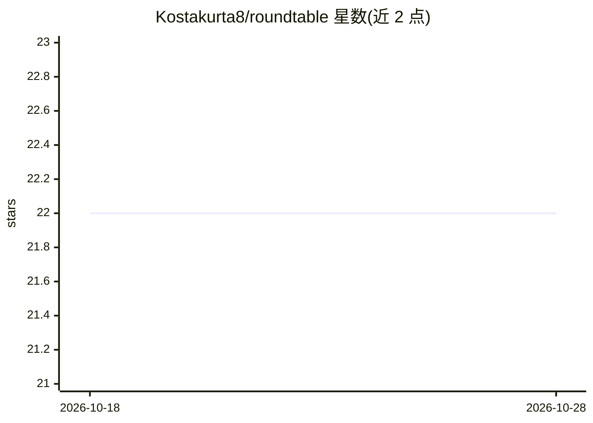

# Kostakurta8/roundtable

⭐ 22 · TypeScript · MIT · 推送 2026-09-27 · [GitHub](https://github.com/Kostakurta8/roundtable) · [官网](https://kostakurta8.github.io/roundtable/) · 个人维护

**将 Claude Code 子代理会话可视化为像素办公室的本地监控工具**

只读读取 Claude Code 写入 ~/.claude 的 JSONL 会话记录，把每个子代理映射为像素办公室中的人物，实时展示谁在工作、各自 token 与成本，支持时间轴回放到任意秒。可将任意会话渲染为 GIF 或 1200×630 卡片，--stats 扫描全部记录并输出用量统计（含去重等计数修正）。不写入 ~/.claude、不装钩子、不调用 API、无出站连接，全程本地。提供 npx 一键运行、npm 全局安装与 Claude Code 插件（/roundtable:gif 等）三种方式，另带浏览器在线演示。

## 筛选速览

| 维度 | 判定 | 备注 |
|---|---|---|
| AI 角色 | `ai-ecosystem` | LLM/agent 周边工具 |
| 许可风险 | `permissive` | MIT |
| 部署形态 | `library` | 以包/库形式分发 |
| 模型依赖 | — | README 未给出锁定关系 |
| 硬件要求 | — | 无带数字的原话,不猜 |
| 安装摩擦 | `low` | 无编译、无系统依赖或容器化 |
| 成熟度 | — | 结构信号不足 |

## 能力要点

- 只读跟踪 ~/.claude JSONL 转录，确定性模拟支持回放任意秒
- 每个子代理的 token（含缓存）与成本估算
- 会话导出为 GIF/PNG 卡片，可隐藏转录文本
- --stats 全量统计并修正 usage 逐行汇总约 3 倍的高估

## 适用场景

- 我想看清多个子代理并行时谁在干活、谁烧 token
- 把一次 agent 会话录成 GIF 或数据卡片分享
- 统计本机所有 Claude Code 会话的真实用量与成本

## 场景标签

`LLM 可观测性` · 领域:评测与运维

## 证据(README 行号)

> L21: `CONFIRMED` or `REFUTED`, and leave through the door when they are done. It reads the transcripts
> L35: - **Find out what your transcripts already say.** `--stats` reads every session you have and
> L39: - **Nothing to trust but a file reader.** It never writes to `~/.claude`, installs no hooks, calls

## 星数曲线

2026-10-18 22 → 2026-10-28 22（+0）

---
*卡片 v1 · prompt 1.4 · 生成 2026-10-27 · 置信度 high · 依据 README sha `ac0a767d9145` · [字段定义](../../DATASET.md)*
