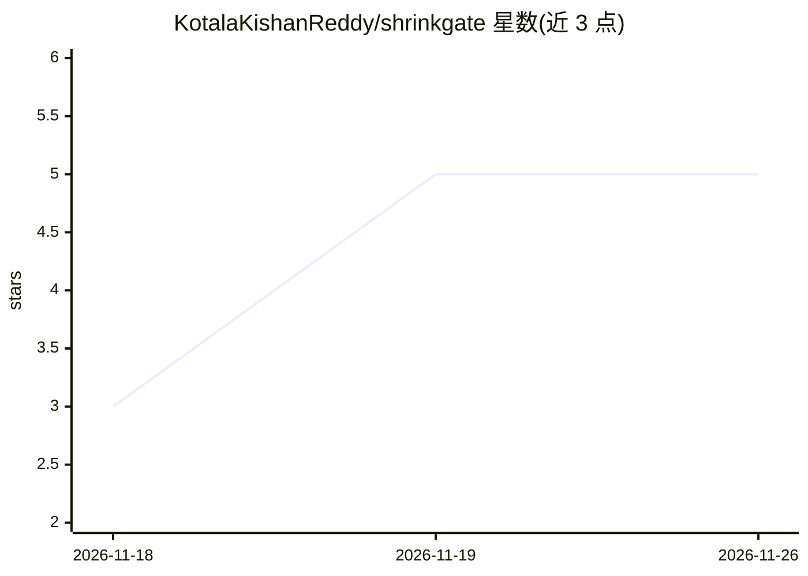

# KotalaKishanReddy/shrinkgate

⭐ 5 · Rust · Apache-2.0 · 推送 2026-11-24 · [GitHub](https://github.com/KotalaKishanReddy/shrinkgate) · [官网](https://crates.io/crates/shrinkgate) · 个人维护

**为 coding agent 本地缩减重复工具输出的 Rust 网关**

ShrinkGate 是运行在本地回环地址的 Rust 网关，代理 coding agent 与模型提供商之间的请求：同一请求内重复出现的工具输出改为哈希占位，仅保留最新一份完整副本；指令、推理与媒体内容不做改写。提供 connect/uninstall/doctor/benchmark/stats 等命令，可对接 Claude Code、Codex、OpenCode 及其他 HTTP 客户端，支持无遥测、可撤销连接与恢复快照。README 明确说明缩减不保证账单降低，且真实节省未经计费凭据验证。

## 筛选速览

| 维度 | 判定 | 备注 |
|---|---|---|
| AI 角色 | `ai-ecosystem` | LLM/agent 周边工具 |
| 许可风险 | `permissive` | Apache-2.0 |
| 部署形态 | `library` | 以包/库形式分发 |
| 模型依赖 | — | README 未给出锁定关系 |
| 硬件要求 | — | 无带数字的原话,不猜 |
| 安装摩擦 | `low` | 无编译、无系统依赖或容器化 |
| 成熟度 | — | 结构信号不足 |

## 能力要点

- 请求内重复工具输出去重，保留最新完整副本
- shrinkgate connect 支持接入 Claude Code / Codex / OpenCode
- 内置 benchmark 与 stats 命令做本地 token 估算
- 无遥测、绑定 loopback、提供恢复快照与撤销连接

## 适用场景

- 减少长会话 coding agent 请求中的重复工具输出
- 在本地基准测试估算请求缩减量
- 为多个 agent 客户端统一配置代理路由

## 场景标签

`编码 Agent` · 领域:编码与开发

## 证据(README 行号)

> L5: A local Rust gateway that removes repeated tool output from coding-agent requests.
> L106: |**Claude Code**|`shrinkgate connect claude`|Messages API; optional `--lean` and `--statusline`; live authenticati
> L128: ShrinkGate binds loopback and forwards requests to your configured provider. It adds no telemetry or extra forward

## 星数曲线

2026-11-18 3 → 2026-11-26 5（+2）

---
*卡片 v1 · prompt 1.4 · 生成 2026-11-21 · 置信度 high · 依据 README sha `fc3081fdea5c` · [字段定义](../../DATASET.md)*
