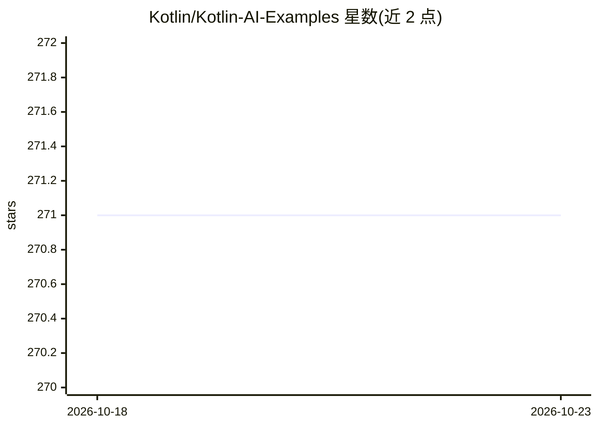

# Kotlin/Kotlin-AI-Examples

⭐ 271 · Jupyter Notebook · Apache-2.0 · 推送 2026-10-01 · [GitHub](https://github.com/Kotlin/Kotlin-AI-Examples) · 组织维护

**Kotlin 集成 AI 框架的示例与交互式笔记本集合**

由 Kotlin 官方组织维护的示例仓库：包含 Spring AI、LangChain4j、MCP、xef.ai 等 Kotlin 完整工程，以及按框架分类的交互式 Kotlin Notebook 教程，覆盖提示词、流式输出、工具调用、RAG、文生图/音频、AI Agent 模式（链式/路由/并行/编排/评估器）、本地 Ollama 运行、GPT-2 推理（KIEngine/ORT）等主题。面向 JVM 开发者，通过 git clone 获取，各工程附独立 README 运行说明，需 Java 17+ 与相应 AI 供应商 API key。

## 筛选速览

| 维度 | 判定 | 备注 |
|---|---|---|
| AI 角色 | `ai-knowledge` | 知识聚合/清单类 |
| 许可风险 | `permissive` | Apache-2.0 |
| 部署形态 | `None` |  |
| 模型依赖 | — | README 未给出锁定关系 |
| 硬件要求 | — | 无带数字的原话,不猜 |
| 安装摩擦 | `medium` | 含编译或系统依赖之一 |
| 成熟度 | — | 结构信号不足 |

## 能力要点

- Spring AI / LangChain4j / MCP / xef.ai 等 Kotlin 工程示例
- Spring AI 十讲系列笔记本（提示词、RAG、文生图、本地 Ollama 等）
- AI Agent 模式笔记本：链式/路由/并行/编排/评估器优化
- GPT-2 与分类任务的本地推理笔记本（KIEngine/ORT）

## 适用场景

- 用 Kotlin 学习接入 Spring AI 或 LangChain4j
- 跟做交互式笔记本掌握 RAG、工具调用与 Agent 模式
- 参考 MCP 服务器与多供应商接入的工程写法

## 场景标签

`教程课程` · 领域:学习与行业

## 证据(README 行号)

> L7: **Kotlin AI Examples** is a repository showcasing various AI frameworks integrated into Kotlin-based projects.
> L39: ## Kotlin Notebooks (`/notebooks`)
> L121: 1. Clone the repository:

## 星数曲线

2026-10-18 271 → 2026-10-23 271（+0）

---
*卡片 v1 · prompt 1.4 · 生成 2026-10-22 · 置信度 high · 依据 README sha `1bf4270a4888` · [字段定义](../../DATASET.md)*
