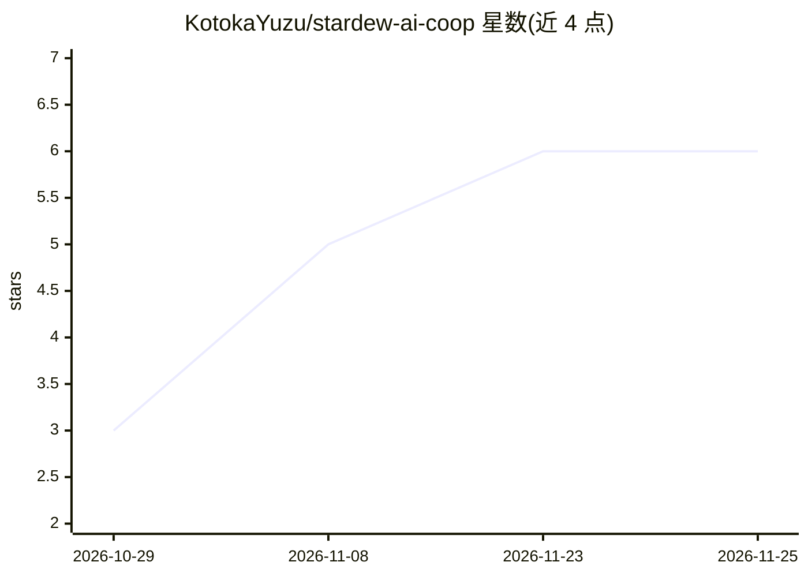

# KotokaYuzu/stardew-ai-coop

⭐ 6 · Python · NOASSERTION · 推送 2026-11-01 · [GitHub](https://github.com/KotokaYuzu/stardew-ai-coop) · 个人维护 · 中文 README

**通过局域网联机加入星露谷农场、执行中文指令的 AI 队友**

基于 SMAPI 模组与第二个游戏窗口的《星露谷物语》AI 队友项目：AI 以原生局域网联机方式加入玩家存档，接收游戏内中文自然语言指令，执行浇水、播种、清理、下矿、钓鱼等操作，并支持聊天陪伴、长期记忆查看编辑和存档数据修改。通过兼容 Chat Completions 的模型接口驱动，返回规划 JSON；要求 Stardew Valley 1.6.15 + SMAPI 4.5.2，Windows 10/11 x64。发布包含便携 Python 与预编译模组，不包含游戏本体与 SMAPI。

## 筛选速览

| 维度 | 判定 | 备注 |
|---|---|---|
| AI 角色 | `ai-native` | 本体是模型或模型工具 |
| 许可风险 | `none` | NOASSERTION |
| 部署形态 | `desktop` | 安装包/桌面程序 |
| 模型依赖 | — | README 未给出锁定关系 |
| 硬件要求 | — | 无带数字的原话,不猜 |
| 安装摩擦 | `medium` | 含编译或系统依赖之一 |
| 成熟度 | `idea` | |

## 能力要点

- AI 队友通过游戏原生局域网联机进入同一存档
- 中文自然语言指令执行农场工作、挖矿、钓鱼等操作
- 游戏数据修改功能（时间/金币/物品生成）可开关
- API Key 使用 Windows DPAPI 加密本地保存

## 适用场景

- 让 AI 队友帮忙完成日常浇水、清理等农活
- 双人联机模式下陪玩、聊天与共同探索矿洞
- 用自然语言修改游戏数据如暂停时间、刷物品

## 场景标签

`GUI 自动化` `Agent 记忆` · 领域:Agent 开发

## 证据(README 行号)

> L3: 给《星露谷物语》添加一位会聊天、能干活的 AI 队友。
> L5: 她会在第二个游戏窗口中，通过原生局域网联机加入你的农场。你可以直接在游戏里和她聊天，告诉她今天想做什么，让她陪你一起经营农场、探索矿洞。
> L106: 模型服务需要兼容 Chat Completions，并能按照项目要求返回规划 JSON。连接测试通过，不代表所有模型或中转站都能可靠完成游戏操作。

## 星数曲线

2026-10-29 3 → 2026-11-25 6（+3）

---
*卡片 v1 · prompt 1.4 · 生成 2026-11-21 · 置信度 high · 依据 README sha `e5d77ad706b7` · [字段定义](../../DATASET.md)*
