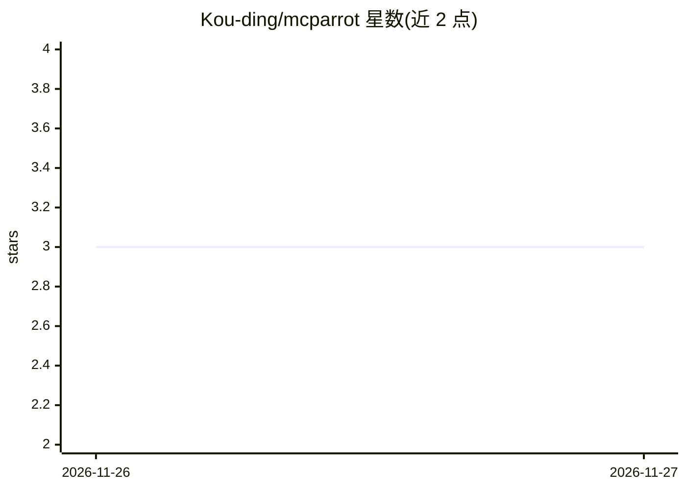

# Kou-ding/mcparrot

⭐ 3 · Python · Apache-2.0 · 推送 2026-11-21 · [GitHub](https://github.com/Kou-ding/mcparrot) · 个人维护

**面向安全研究人员的多 Agent 渗透测试自动化框架**

以文件为中心的渗透测试自动化框架，通过专用 MCP 服务器（自制的 Nmap、Gobuster、SQLmap、Hashcat、Metasploit、沙箱终端封装）驱动安全工具执行任务。提供两种运行模式：用户提示驱动的 Hawk 模式，与仅需目标 IP 端到端执行的 Raven 全自主多 Agent 编排模式。工作流按侦察、漏洞评估、利用三阶段组织为有限状态机，采用黑板式内存管理拆分消息历史、阶段计划与摘要以缓解上下文窗口饱和。依赖 Linux 环境与 Anthropic 格式 API，声明仅供教育与授权测试用途。

## 筛选速览

| 维度 | 判定 | 备注 |
|---|---|---|
| AI 角色 | `ai-native` | 本体是模型或模型工具 |
| 许可风险 | `permissive` | Apache-2.0 |
| 部署形态 | `None` |  |
| 模型依赖 | — | README 未给出锁定关系 |
| 硬件要求 | — | 无带数字的原话,不猜 |
| 安装摩擦 | `low` | 无编译、无系统依赖或容器化 |
| 成熟度 | — | 结构信号不足 |

## 能力要点

- Hawk（用户驱动）与 Raven（全自主）两种任务执行模式
- FSM 三阶段工作流：侦察/漏洞评估/利用
- 黑板式内存管理拆分消息历史、阶段计划与摘要
- 单文件 Python 网络安全 MCP 服务器集合

## 适用场景

- 对授权目标执行端到端自动化渗透测试
- 用自然语言提示驱动定向安全测试任务
- 在 Cybench 类基准上评估 Agent 渗透能力

## 场景标签

`多智能体` `网络安全` `工作流自动化` · 领域:Agent 开发

## 证据(README 行号)

> L18:  MCParrot : A File-Centric Penetration Testing Automation Framework Utilizing Specialized Agents.
> L102: - **🐦‍⬛ Raven Mode (Methodical & Autonomous)**: A **fully autonomous**, multi-agent orchestration mode that requir
> L107: - **🛠️ Cybersecurity MCP servers**: Single-file Python MCP servers.

## 星数曲线

2026-11-26 3 → 2026-11-27 3（+0）

---
*卡片 v1 · prompt 1.4 · 生成 2026-11-26 · 置信度 high · 依据 README sha `27658e9585d6` · [字段定义](../../DATASET.md)*
