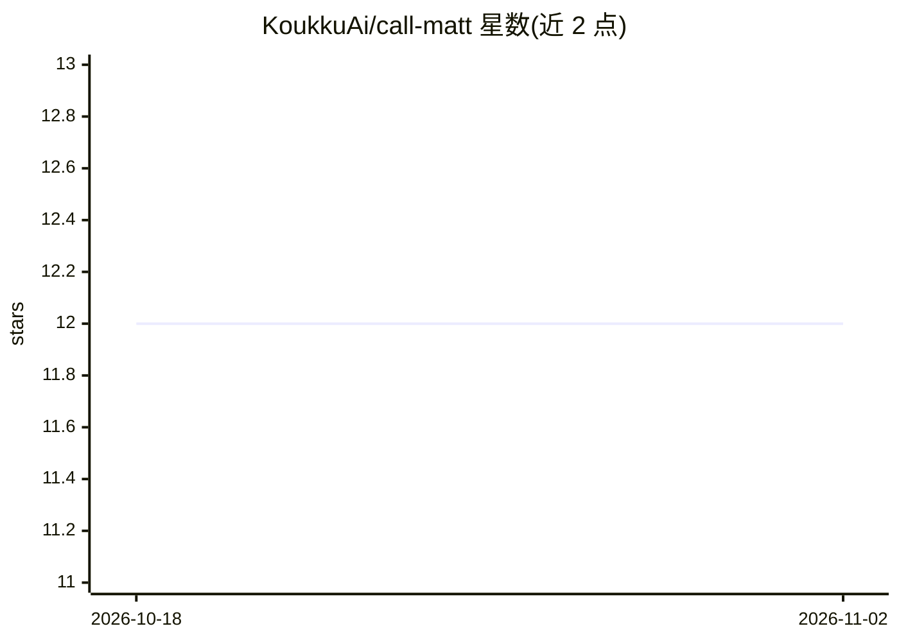

# KoukkuAi/call-matt

⭐ 12 · Python · MIT · 推送 2026-10-07 · [GitHub](https://github.com/KoukkuAi/call-matt) · [官网](https://www.johntammi.fi/en) · 个人维护

**为 Matt Pocock 的 agent 技能提供统一路由的编排技能**

社区构建的元技能（SKILL.md 格式），根据用户描述的开发情境（如想法模糊、待办混乱、神秘 bug）从 Matt Pocock 的 14+ 个 MIT 技能中选择合适的一个或序列，并给出下一步命令。同一路由逻辑通过构建脚本生成四个端口，适配 Claude Code、Google Antigravity、OpenAI Codex 与 Hermes Agent，仅调用方式与安装目录不同。安装需先装上游技能包，再按各 agent 目录放置文件；明确声明与 Matt Pocock 无隶属关系。

## 筛选速览

| 维度 | 判定 | 备注 |
|---|---|---|
| AI 角色 | `ai-ecosystem` | LLM/agent 周边工具 |
| 许可风险 | `permissive` | MIT |
| 部署形态 | `library` | 以包/库形式分发 |
| 模型依赖 | — | README 未给出锁定关系 |
| 硬件要求 | — | 无带数字的原话,不猜 |
| 安装摩擦 | `low` | 无编译、无系统依赖或容器化 |
| 成熟度 | — | 结构信号不足 |

## 能力要点

- 根据情境在 18 个被路由技能中选型并给出下一步命令
- 单一源文件经 scripts/build.py 生成四个 agent 端口，构建时校验 frontmatter 与 12 条路由规则
- 覆盖 grill→PRD→issues→prototype→tdd 的开发生命周期路由表
- 声明不冒充 Matt Pocock，非官方社区项目（MIT）

## 适用场景

- 我不知道该用 Matt 技能包里哪个命令时帮我选
- 在 Claude Code/Codex 等多个 agent 间复用同一套路由逻辑
- 按开发生命周期阶段推进：想法→PRD→issue→原型→TDD

## 场景标签

`Agent 框架` · 领域:Agent 开发

## 证据(README 行号)

> L4: **An unofficial orchestrator skill for Matt Pocock's agent skills.**
> L27: `/call-matt` is a meta-skill that acts as a **router and strategic coach**. Describe where you are ("I have a vague
> L30: 2. **Picks the playbook** — the exact skill (or sequence) to run right now, and why

## 星数曲线

2026-10-18 12 → 2026-11-02 12（+0）

---
*卡片 v1 · prompt 1.4 · 生成 2026-11-01 · 置信度 mid · 依据 README sha `daf083bcb8dd` · [字段定义](../../DATASET.md)*
