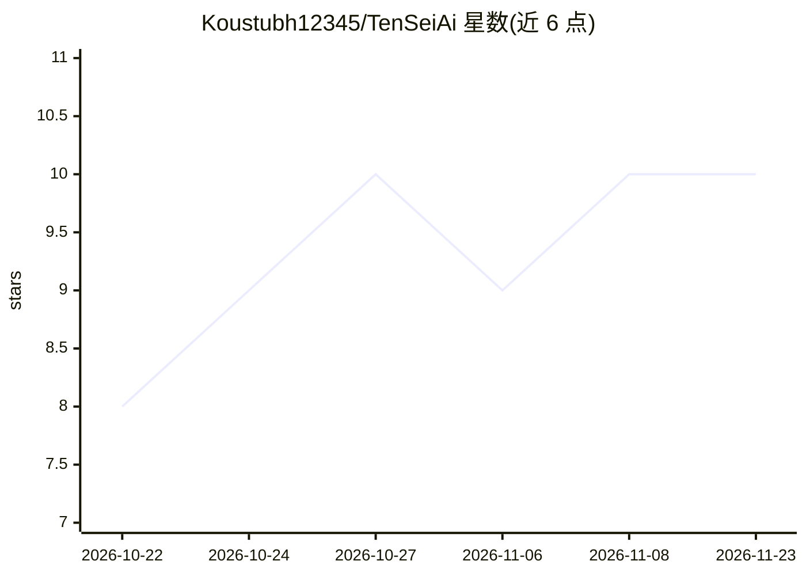

# Koustubh12345/TenSeiAi

⭐ 10 · Python · MIT · 推送 2026-10-21 · [GitHub](https://github.com/Koustubh12345/TenSeiAi) · 个人维护

**纯 Python/NumPy 的离线 MoE 语言模型引擎，可在手机 CPU 运行**

从零实现的 Mixture-of-Experts 语言模型与离线 AI 引擎，不依赖 PyTorch、TensorFlow、GGUF/llama.cpp 或 Hugging Face transformers，仅用 Python 3.12+ 与 NumPy 运行。模型约 19.74M 参数，打包为约 81 MB 的单文件 ZipApp，支持终端聊天、本地 Web UI 与 OpenAI 兼容 REST API（绑定 127.0.0.1）。默认严格离线零网络调用，可通过 /web on 开启联网检索、/feed on 开启后台知识扩充。提供 Android APK 与 Termux 安装路径。

## 筛选速览

| 维度 | 判定 | 备注 |
|---|---|---|
| AI 角色 | `ai-native` | 本体是模型或模型工具 |
| 许可风险 | `permissive` | MIT |
| 部署形态 | `library` | 以包/库形式分发 |
| 模型依赖 | — | README 未给出锁定关系 |
| 硬件要求 | — | 无带数字的原话,不猜 |
| 安装摩擦 | `low` | 无编译、无系统依赖或容器化 |
| 成熟度 | — | 结构信号不足 |

## 能力要点

- 单文件 ~81 MB ZipApp 分发，仅依赖 Python 3.12+ 与 NumPy
- 2-block Transformer + top-1 MoE（4 专家），CPU 推理延迟 <0.05s
- 混合架构：MoE 核心 + 稠密语义嵌入 + SQLite FTS5/BM25 检索 + 确定性求解器
- 提供 OpenAI 兼容 /v1/chat/completions 端点与 Python 客户端示例

## 适用场景

- 在 Android 手机（Termux/APK）上离线运行语言模型
- 在树莓派或 CPU 服务器上做无 GPU 推理
- 隐私敏感环境（零遥测、可 air-gap）下的本地问答
- 通过 OpenAI 兼容 API 接入本地小型模型

## 场景标签

`推理引擎` `聊天机器人` · 领域:对话与助手

## 证据(README 行号)

> L5: **Engineered in pure Python and NumPy. Zero PyTorch. Zero GGUF. Zero Cloud Dependencies.**
> L27: TenSeiAi is an ultra-lightweight, high-speed neural AI system engineered to deliver maximum intelligence per megaby
> L122: |**Language Core**|Custom 2-block Transformer with top-1 Mixture-of-Experts (MoE) FFN|

## 星数曲线

2026-10-22 8 → 2026-11-23 10（+2）

---
*卡片 v1 · prompt 1.4 · 生成 2026-11-20 · 置信度 mid · 依据 README sha `8673fbd28bba` · [字段定义](../../DATASET.md)*
