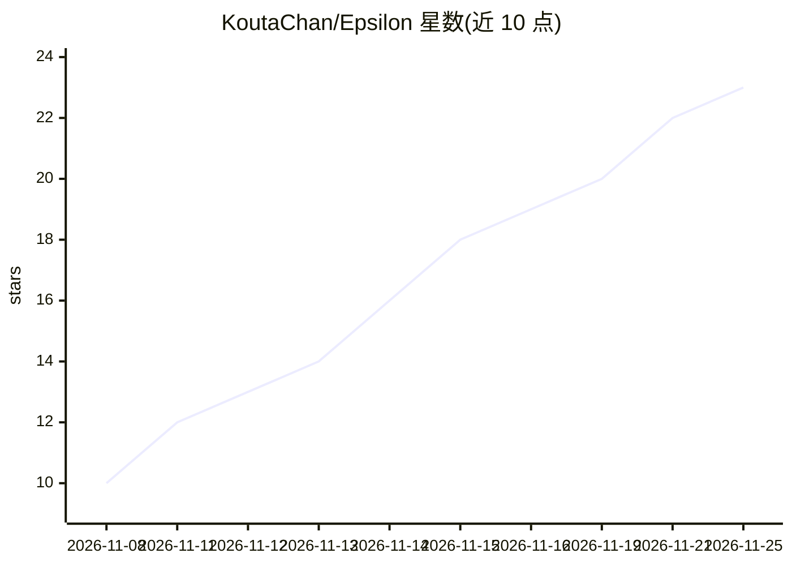

# KoutaChan/Epsilon

⭐ 23 · Java · GPL-3.0 · 推送 2026-11-22 · [GitHub](https://github.com/KoutaChan/Epsilon) · 个人维护

**Java 编写的立直麻将 AI，支持学习、自我对局与牌谱解析**

基于 Java 21 与 DJL/PyTorch 的立直麻将 AI，分三个系列：从牌谱学习并自我对弈的 Epsilon-Nano 与 Epsilon（README 标注 Outdated，仅最小限度维护）、仅靠自我对弈训练的 Epsilon-Prism（四人/三人麻将，约1.94M参数）。支持牌谱学习、AI 互相对局、RiichiLab 对战与牌谱解析；附带 Epsilon AI 审阅器用于 AI 解析牌谱并查看候选行动。GPL v3 开源。

## 筛选速览

| 维度 | 判定 | 备注 |
|---|---|---|
| AI 角色 | `ai-native` | 本体是模型或模型工具 |
| 许可风险 | `viral` | GPL-3.0 |
| 部署形态 | `None` |  |
| 模型依赖 | — | README 未给出锁定关系 |
| 硬件要求 | — | 无带数字的原话,不猜 |
| 安装摩擦 | `medium` | 含编译或系统依赖之一 |
| 成熟度 | — | 结构信号不足 |

## 能力要点

- 牌谱学习与自我对弈强化学习
- Epsilon-Prism（约1.94M参数）支持四人/三人麻将
- Epsilon AI 审阅器：AI 解析牌谱并展示行动候选
- 可运行学习、评估与对局

## 适用场景

- 立直麻将 AI 研究与训练实验
- 用 AI 解析自己的牌谱查看候选行动
- 让不同 AI 互相对局评估棋力

## 场景标签

`强化学习` · 领域:训练与推理

## 证据(README 行号)

> L3: **Riichi Mahjong AI**
> L18: Epsilonは、JavaとDJL / PyTorchを使ったリーチ麻雀AIです。牌譜からの学習と自己対戦による追加学習に対応したEpsilon-Nano・Epsilonと、自己対戦だけで育てる四人打ち・三人打ちのEpsilon-

## 星数曲线

2026-11-08 10 → 2026-11-25 23（+13）

---
*卡片 v1 · prompt 1.4 · 生成 2026-11-18 · 置信度 high · 依据 README sha `1e9f4e0e2dc3` · [字段定义](../../DATASET.md)*
