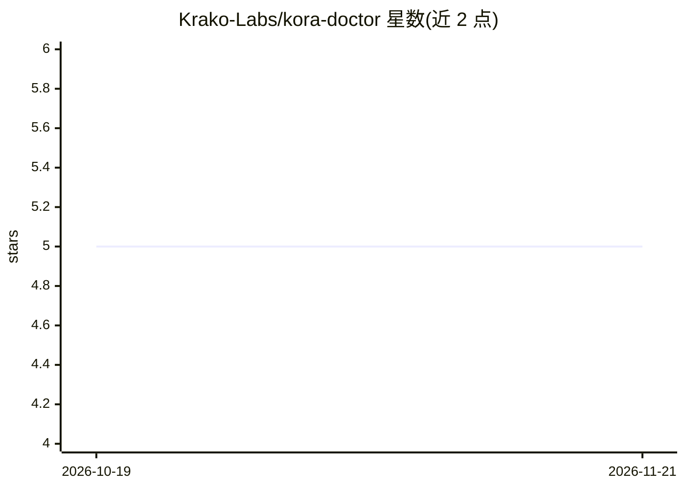

# Krako-Labs/kora-doctor

⭐ 5 · Python · NOASSERTION · 推送 2026-11-13 · [GitHub](https://github.com/Krako-Labs/kora-doctor) · 组织维护

**本地 CLI：审计 agent 用量记录，找出可疑浪费的 LLM 调用**

读取 AUDR JSON/JSONL 格式的 agent 执行记录，输出带证据与置信度的执行浪费候选报告，覆盖重复调用、重试开销、上下文放大、死工作与循环、可确定化任务、模型选择六类信号；可选接入 OpenTelemetry/OTLP JSON sidecar 丰富证据。纯本地运行，无账号、无托管服务、无运行时依赖，不修改 agent 也不自动跳过调用；明确声明结果是假设而非已验证的节省。需 Python 3.9+，经 pipx 或 venv 从 GitHub 安装，Apache-2.0 许可。

## 筛选速览

| 维度 | 判定 | 备注 |
|---|---|---|
| AI 角色 | `ai-ecosystem` | LLM/agent 周边工具 |
| 许可风险 | `none` | NOASSERTION |
| 部署形态 | `library` | 以包/库形式分发 |
| 模型依赖 | — | README 未给出锁定关系 |
| 硬件要求 | — | 无带数字的原话,不猜 |
| 安装摩擦 | `low` | 无编译、无系统依赖或容器化 |
| 成熟度 | `idea` | |

## 能力要点

- 读取 AUDR JSON/JSONL，输出带证据与置信度的浪费候选发现
- 六类检测信号：重复调用、重试开销、上下文与缓存、死工作与循环、确定化候选、模型选择
- 可选 OTel/OTLP sidecar 用 span 状态与指纹丰富证据
- 本地运行，不上传 trace，无运行时依赖

## 适用场景

- 审计自有 agent 的调用记录，定位可省的重复/无效 LLM 调用
- 评估是否可将短任务换到更小模型上执行
- 在本地离线环境分析敏感 trace 而不上传数据

## 场景标签

`LLM 可观测性` · 领域:评测与运维

## 证据(README 行号)

> L5:  A local-first CLI that turns agent usage records into evidence-backed execution-waste candidates.
> L20: KORA Doctor reads AUDR JSON/JSONL and reports **candidate findings with evidence and confidence**. It does not modi

## 星数曲线

2026-10-19 5 → 2026-11-21 5（+0）

---
*卡片 v1 · prompt 1.4 · 生成 2026-11-21 · 置信度 mid · 依据 README sha `fec26e25032a` · [字段定义](../../DATASET.md)*
