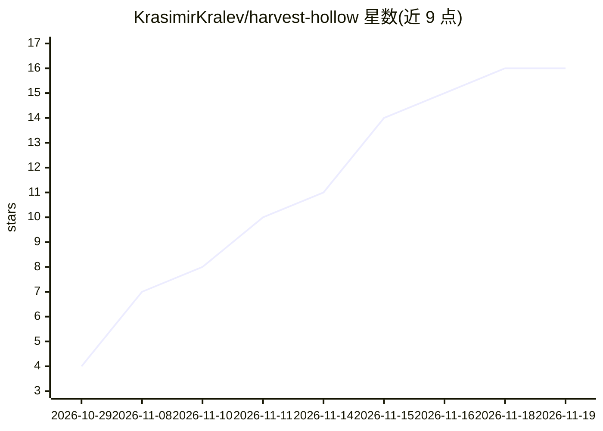

# KrasimirKralev/harvest-hollow

⭐ 16 · JavaScript · MIT · 推送 2026-10-23 · [GitHub](https://github.com/KrasimirKralev/harvest-hollow) · [官网](https://krasimirkralev.github.io/harvest-hollow/) · 个人维护

**双人合作的浏览器 3D 农场游戏，附 AI 愿望改模助手**

面向两名玩家的合作农场经营网页游戏：Node 服务器运行一个共享农场，双方在浏览器中实时种植、养殖、制造、装饰与完成任务；同一套确定性 JavaScript 规则引擎在浏览器预测动作、在服务器裁决，存档为带日志与备份的 JSON 文件。自托管者可启用 Harvey：输入愿望后由其生成数据文件形式的 mod（不写游戏代码），在农场副本测试后一键应用，支持 Claude Code 与 ChatGPT 登录两种提供方，无需 API key；Harvey 可隐藏或关闭。免费公开托管或自行部署（Node 24 + npm）。

## 筛选速览

| 维度 | 判定 | 备注 |
|---|---|---|
| AI 角色 | `ai-enhanced` | 去掉 AI 部分产品仍成立 |
| 许可风险 | `permissive` | MIT |
| 部署形态 | `self-host` | docker 或自建部署 |
| 模型依赖 | locked-api |  |
| 硬件要求 | — | 无带数字的原话,不猜 |
| 安装摩擦 | `low` | 无编译、无系统依赖或容器化 |
| 成熟度 | — | 结构信号不足 |

## 能力要点

- 双人共享农场的浏览器实时合作玩法（PC/平板/手机）
- Harvey 愿望转 mod：只写数据文件不写游戏代码，副本测试后一键应用并可撤销
- 同一确定性规则引擎浏览器预测 + 服务器裁决，存档为带日志与备份的单个 JSON
- 单 HTTP+WebSocket 端口部署，提供 systemd、Tailscale/Cloudflare 隧道与 Dockerfile 方案

## 适用场景

- 和朋友在浏览器里一起经营一个共享农场
- 把旧笔记本或树莓派变成 24/7 家庭农场服务器
- 用自然语言让 Harvey 生成新作物/料理等游戏内容 mod
- 以 HH_MODE=multi 搭建面向多用户的公开托管站点

## 场景标签

 · 领域:游戏

## 证据(README 行号)

> L5:  A cozy 3D farming game for two, in the browser.
> L68: The purple wand button (the phone's farm menu has a tile too) opens **Harvey**. Type or speak a wish ("a pale blue
> L77: Each farmer signs in with their **own plan**, no API keys: **Claude** (the server runs the unmodified Claude Code

## 星数曲线

2026-10-29 4 → 2026-11-19 16（+12）

---
*卡片 v1 · prompt 1.4 · 生成 2026-11-18 · 置信度 high · 依据 README sha `01ec0a503b76` · [字段定义](../../DATASET.md)*
