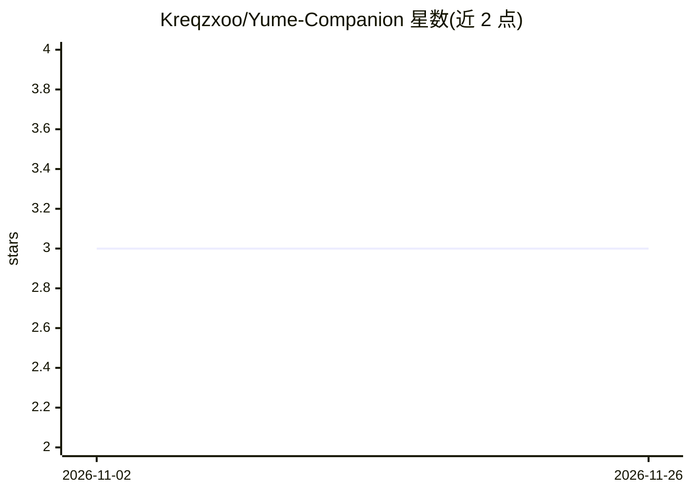

# Kreqzxoo/Yume-Companion

⭐ 3 · Python · GPL-3.0 · 推送 2026-11-04 · [GitHub](https://github.com/Kreqzxoo/Yume-Companion) · [官网](https://kreqzxoo.github.io/Yume-Companion/) · 个人维护

**面向消费者的本地 AI 陪伴应用（Windows/Android）**

Yume Companion 是一个运行在 Windows 与 Android 上的 AI 陪伴程序：角色通过长期记忆（事实、日记、用户画像）、文字与语音聊天、Live2D/VRM 头像、唤醒词通话和角色扮演舞台与用户交互，并提供日程、提醒、邮件只读等助理功能。语言模型通过 llama.cpp 运行 GGUF，或接 Ollama/OpenAI 兼容端点及多家云服务商；TTS、STT、视觉、情绪分类等模型可全本地运行。基于 jofizcd 的 Soul of Waifu（GPL-3.0）扩展修改，当前版本 3.0.0 beta。

## 筛选速览

| 维度 | 判定 | 备注 |
|---|---|---|
| AI 角色 | `ai-native` | 本体是模型或模型工具 |
| 许可风险 | `viral` | GPL-3.0 |
| 部署形态 | `desktop` | 安装包/桌面程序 |
| 模型依赖 | local-ok | 支持本地模型 |
| 硬件要求 | — | 无带数字的原话,不猜 |
| 安装摩擦 | `medium` | 含编译或系统依赖之一 |
| 成熟度 | — | 结构信号不足 |

## 能力要点

- llama.cpp 本地运行任意 GGUF 模型，或接入 Ollama/OpenAI 兼容端点与多家云服务商
- 长期记忆系统：事实、感受、用户画像与日记，4 种模式加自动摘要
- 28 种情绪分类驱动 Live2D/VRM 头像表情与动作
- Android 端可设为默认助手，支持唤醒词、AI 手机控制与离线应急模式

## 适用场景

- 在 PC 和手机上与本地运行的角色聊天、语音通话
- 完全离线私密地使用 AI 陪伴功能
- 把 AI 角色作为桌面伴侣与日常助理使用

## 场景标签

`聊天机器人` `AI 助手` `语音 Agent` · 领域:对话与助手

## 证据(README 行号)

> L28: Yume Companion is a Windows application where AI characters remember you, react to you, and are reachable everywher
> L52: |**Language model** (the "personality")|Any GGUF model via **llama.cpp** (CUDA, Vulkan, HIP, SYCL or CPU), Ollama, 

## 星数曲线

2026-11-02 3 → 2026-11-26 3（+0）

---
*卡片 v1 · prompt 1.4 · 生成 2026-11-22 · 置信度 high · 依据 README sha `73ad099fc4b3` · [字段定义](../../DATASET.md)*
