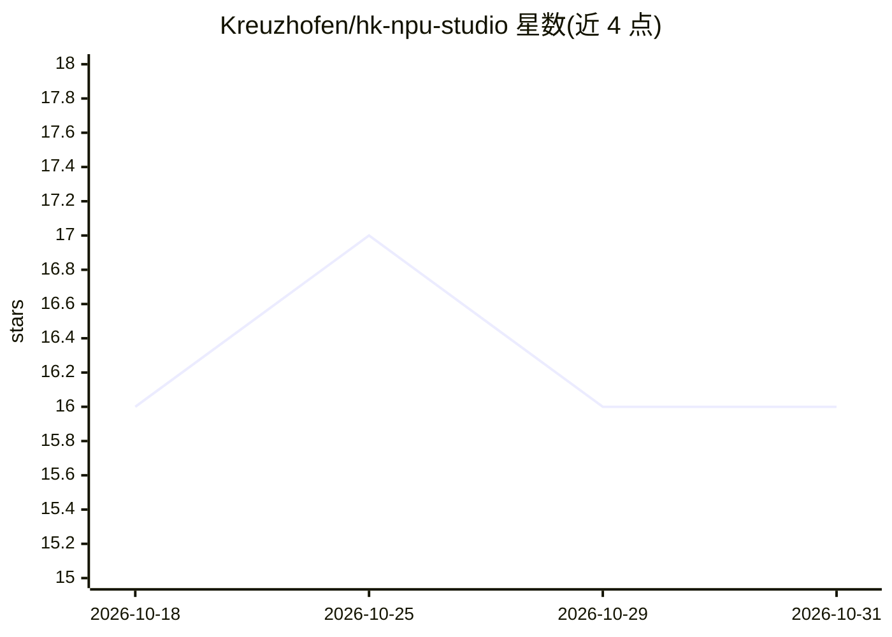

# Kreuzhofen/hk-npu-studio

⭐ 16 · Python · NOASSERTION · 推送 2026-10-30 · [GitHub](https://github.com/Kreuzhofen/hk-npu-studio) · 个人维护

**Snapdragon PC 上本地 NPU 图像生成桌面应用**

面向 Windows 11 ARM64 Snapdragon X 系列的源码可用专有桌面应用，为本地 Stable Diffusion 图像生成提供模型发现、下载、校验、激活与推理的一站式流程（Phoenix Engine 协调）。支持 SD 1.5/2.1/3.5 Medium，走 Qualcomm QNN/Hexagon NPU 与 ONNX Runtime 推理。附带 Phoenix Boost 提示词增强（确定性规则本地模式，或可选 Ollama+Qwen2.5 本地大模型）、FiDeSR 照片修复（4× 超分，无 CPU/GPU AI 回退）、ControlNet Canny、批量生成（1–99 张）。当前为 2.0 RC4 阶段。

## 筛选速览

| 维度 | 判定 | 备注 |
|---|---|---|
| AI 角色 | `ai-native` | 本体是模型或模型工具 |
| 许可风险 | `none` | NOASSERTION |
| 部署形态 | `desktop` | 安装包/桌面程序 |
| 模型依赖 | local-ok | 支持本地模型 |
| 硬件要求 | — | 无带数字的原话,不猜 |
| 安装摩擦 | `low` | 无编译、无系统依赖或容器化 |
| 成熟度 | `idea` | |

## 能力要点

- 本地 NPU 加速的 Stable Diffusion 图像生成（QNN/Hexagon + ONNX Runtime）
- Phoenix Boost 提示词增强：确定性本地规则模式，或可选 Ollama+Qwen2.5
- FiDeSR AI 照片修复：多 tile 原生分辨率处理与 4× 超分，模型随安装器打包
- 18 项生成参数原子化持久化与 1–99 张顺序批量生成

## 适用场景

- 在 Snapdragon X 笔记本上离线运行 Stable Diffusion 生图，无需理解模型包与 QNN 内部结构
- 把简单提示词增强为更丰富的图像提示词
- 修复老照片、受损或黑白照片并 4× 放大

## 场景标签

`图像生成` `图像视频处理` · 领域:内容生成

## 证据(README 行号)

> L46: **HK NPU STUDIO** is an independent source-available proprietary desktop application for local generative AI on Win
> L52: > **Install HK NPU STUDIO → select a model → generate an image.**
> L185: |**Inference**|Qualcomm QNN / Hexagon NPU|✅ Integrated|Local accelerated execution for compatible model pipelines.

## 星数曲线

2026-10-18 16 → 2026-10-31 16（+0）

---
*卡片 v1 · prompt 1.4 · 生成 2026-10-30 · 置信度 mid · 依据 README sha `4cae4e4c6b51` · [字段定义](../../DATASET.md)*
