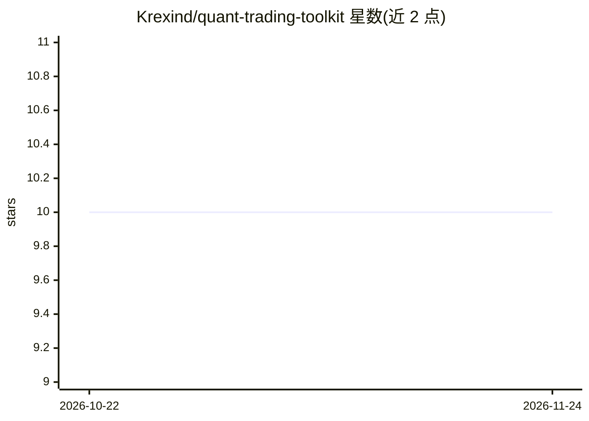

# Krexind/quant-trading-toolkit

⭐ 10 · C# · MIT · 推送 2026-11-22 · [GitHub](https://github.com/Krexind/quant-trading-toolkit) · 个人维护

**为量化交易者提供技术指标策略脚本与可插拔回测框架**

仓库收录多种技术指标自动化交易策略脚本，包括动量交易、开盘区间突破、支撑阻力反转与统计套利等，全部基于历史数据回测/前瞻测试，假设交易无摩擦（无滑点、无手续费）。以 Python 编写，各脚本包含 main 全局函数可直接嵌入用户交易系统。平台以 PyPI 包与 CLI 形式分发，采用插件架构，组件模块化、环境无关（回测/sandbox/实盘）、交易所接口统一，另提供 Docker 运行插件的方式。

## 筛选速览

| 维度 | 判定 | 备注 |
|---|---|---|
| AI 角色 | `ai-enhanced` | 去掉 AI 部分产品仍成立 |
| 许可风险 | `permissive` | MIT |
| 部署形态 | `self-host` | docker 或自建部署 |
| 模型依赖 | — | README 未给出锁定关系 |
| 硬件要求 | — | 无带数字的原话,不猜 |
| 安装摩擦 | `low` | 无编译、无系统依赖或容器化 |
| 成熟度 | — | 结构信号不足 |

## 能力要点

- 插件架构：模块化组件，环境无关（backtest/sandbox/live）
- 统一接口适配多个交易所与数据供应商
- 内置 London Breakout 等开盘区间突破与统计套利策略
- 脚本含 main 全局函数，可直接嵌入交易系统

## 适用场景

- 回测技术指标交易策略的历史表现
- 以插件形式扩展指标、策略与风控组件
- 通过 CLI 或 Python 接口访问行情数据与策略

## 场景标签

`金融量化` · 领域:学习与行业

## 证据(README 行号)

> L13: Most scripts inside this repository are technical indicator automated trading. These scripts include various types 
> L22: - 🔌 Modular & reusable components
> L31: While the Quant-Trading Platform is all about an integration to dozens of different data vendors, the interface is 

## 星数曲线

2026-10-22 10 → 2026-11-24 10（+0）

---
*卡片 v1 · prompt 1.4 · 生成 2026-11-20 · 置信度 mid · 依据 README sha `64a1974cb421` · [字段定义](../../DATASET.md)*
