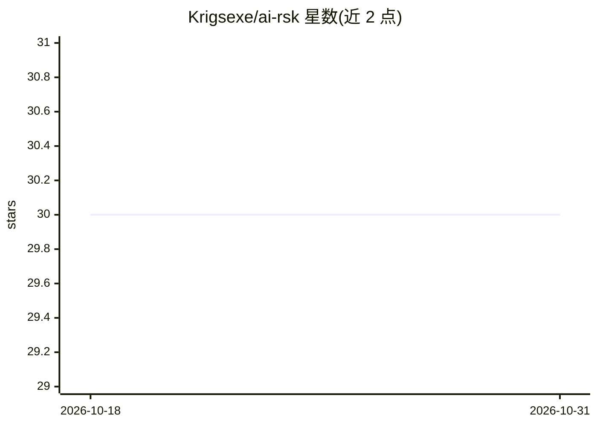

# Krigsexe/ai-rsk

⭐ 30 · Rust · MIT · 推送 2026-03-19 · [GitHub](https://github.com/Krigsexe/ai-rsk) · [官网](https://airsk.organicascode.me) · 个人维护

**拦截 AI 生成代码安全风险的构建安全门 CLI**

单个 Rust 二进制的安全扫描 CLI：阻断构建直到安全问题修复。内置 67 条离线确定性规则（Tree-sitter AST 过滤误报），按 5 类合规档案（security/GDPR/AI Act/SEO/可访问性）激活；自动安装并管理 Semgrep、Gitleaks、osv-scanner、knip 等外部工具；另有 18 项项目结构检查（缺测试、死依赖、CI 缺失等）。ai-rsk init 生成配置、安全规则文档及面向 16 种 AI 编程工具（Claude Code、Cursor、Copilot 等）的约束文件，并提供 Git hooks 与 CI 集成。覆盖 JS/TS、Python、Go、Rust、HTML 生态。

## 筛选速览

| 维度 | 判定 | 备注 |
|---|---|---|
| AI 角色 | `ai-ecosystem` | LLM/agent 周边工具 |
| 许可风险 | `permissive` | MIT |
| 部署形态 | `desktop` | 安装包/桌面程序 |
| 模型依赖 | — | README 未给出锁定关系 |
| 硬件要求 | — | 无带数字的原话,不猜 |
| 安装摩擦 | `low` | 无编译、无系统依赖或容器化 |
| 成熟度 | — | 结构信号不足 |

## 能力要点

- 67 条内置规则 + Tree-sitter AST 过滤，离线确定性检测
- 自动安装并管理 Semgrep/Gitleaks/osv-scanner/knip 外部工具
- 5 类合规档案：security/GDPR/EU AI Act/SEO/可访问性
- 为 16 种 AI 编程工具生成约束文件，含 Git hooks 与 CI 集成

## 适用场景

- 阻止 LLM 生成的不安全代码通过构建部署到生产环境
- 在 CI 中对 AI 辅助开发项目执行安全与合规门禁
- 满足 GDPR、EU AI Act 等合规要求的项目检查

## 场景标签

`网络安全` `代码审查` · 领域:编码与开发

## 证据(README 行号)

> L19: ai-rsk blocks your build until security issues are fixed. One Rust binary. 67 built-in rules. 5 compliance profiles
> L108: - `SECURITY_RULES.md` - contract between ai-rsk and the LLM (adapts to selected profiles)
> L109: - LLM discipline files for 16 AI coding tools (Claude Code, Cursor, Copilot, Windsurf, Cline, Gemini CLI, Codex CL

## 星数曲线

2026-10-18 30 → 2026-10-31 30（+0）

---
*卡片 v1 · prompt 1.4 · 生成 2026-10-26 · 置信度 mid · 依据 README sha `46c627d42189` · [字段定义](../../DATASET.md)*
