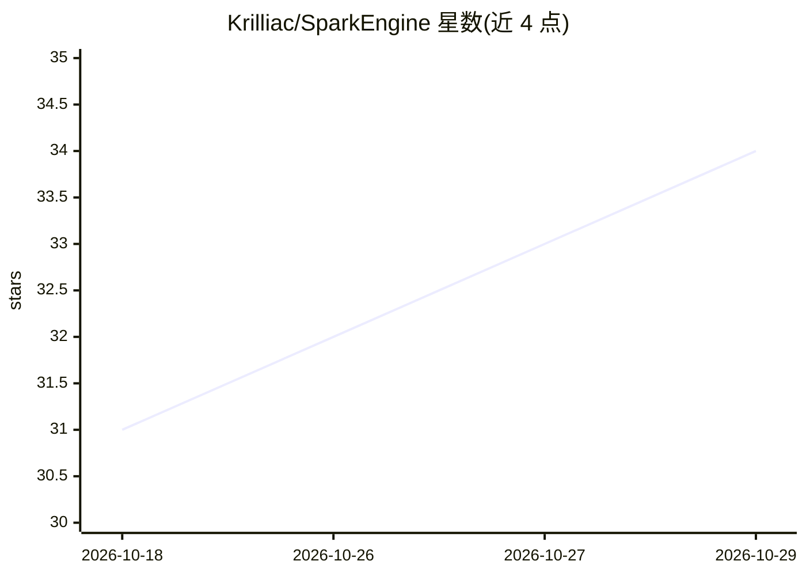

# Krilliac/SparkEngine

⭐ 34 · C++ · NOASSERTION · 推送 2026-10-18 · [GitHub](https://github.com/Krilliac/SparkEngine) · 个人维护

**源码可得的 C++23 3D 游戏引擎，面向 FPS 及多类型游戏开发**

C++23 编写的 3D 游戏引擎，最初围绕第一人称射击构建，现含 RPG/MMO/RTS/竞速/开放世界/平台跳跃等模板。通过共享 RHI 抽象提供 DirectX 11/12、Vulkan 1.4、OpenGL、Metal、NullRHI 六个后端（多数标注为 experimental、stable-v1 之外），集成 Jolt Physics、EnTT ECS、AngelScript/可视化脚本、ImGui 编辑器（64 个面板类）与 UDP 网络架构。README 大量区分 stable-v1 认证状态与设计目标，声明尚无经认证的稳定版本，需从源码构建（MSVC/GCC/Clang + CMake）。AI/导航部分为行为树、NavMesh 与感知系统等子模块。

## 筛选速览

| 维度 | 判定 | 备注 |
|---|---|---|
| AI 角色 | `ai-enhanced` | 去掉 AI 部分产品仍成立 |
| 许可风险 | `none` | NOASSERTION |
| 部署形态 | `desktop` | 安装包/桌面程序 |
| 模型依赖 | — | README 未给出锁定关系 |
| 硬件要求 | — | 无带数字的原话,不猜 |
| 安装摩擦 | `medium` | 含编译或系统依赖之一 |
| 成熟度 | `idea` | |

## 能力要点

- 六图形后端共享 RHI 抽象（DX11/12、Vulkan 1.4、OpenGL、Metal、NullRHI）
- Jolt Physics 刚体/载具/布料/破坏，支持回放与多人确定性模式
- AngelScript 热重载与 69 节点可视化脚本，34 节点 Shader Graph
- 九个运行时加载的游戏模块模板（均标注 stable-v1 之外）

## 适用场景

- 用 C++23 从源码构建并开发 FPS 或多类型 3D 游戏
- 在 ImGui 编辑器中搭建场景、地形、武器与对话等内容
- 使用内置 UDP 网络与 AreaServer/WorldServer 架构做多人/MMO 玩法

## 场景标签

 · 领域:游戏开发/图形引擎

## 证据(README 行号)

> L3: A C++23 source-available 3D game engine with multiple graphics backends behind a shared RHI surface, ECS (EnTT), Jol

## 星数曲线

2026-10-18 31 → 2026-10-29 34（+3）

---
*卡片 v1 · prompt 1.4 · 生成 2026-10-26 · 置信度 high · 依据 README sha `8b5d97111e64` · [字段定义](../../DATASET.md)*
