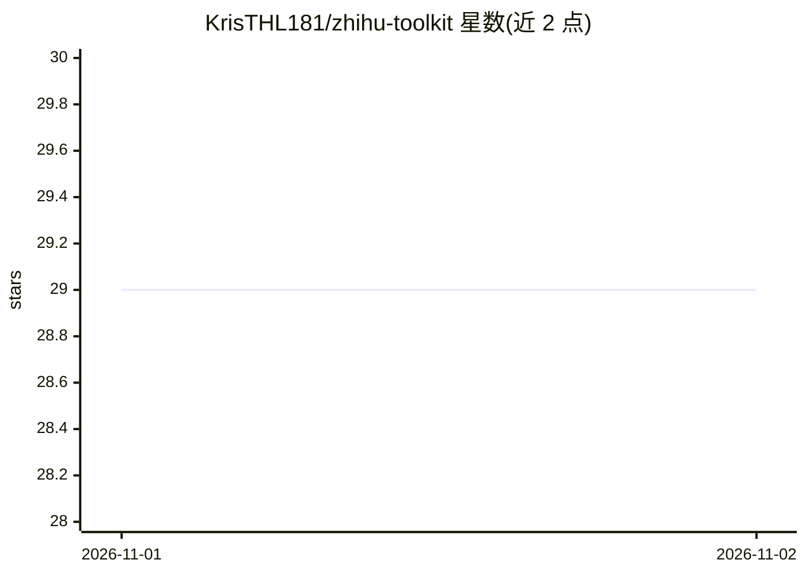

# KrisTHL181/zhihu-toolkit

⭐ 29 · Python · MIT · 推送 2026-10-31 · [GitHub](https://github.com/KrisTHL181/zhihu-toolkit) · 个人维护 · 中文 README

**非官方知乎命令行工具：终端内浏览/下载/发布/分析知乎内容**

基于 Python 3.10+ 的非官方知乎 CLI 工具包：认证一次后可在终端浏览热榜/问题/文章/想法，搜索，将内容批量导出为带 YAML frontmatter 的 Markdown，用 Markdown 撰写并发布回答与文章，执行点赞/关注/评论等社交操作，多账号切换；创作者收益分析与图表、词频/词云/K-means 聚类等 NLP 功能为可选依赖安装。请求经 ZSE v4 签名与 curl_cffi TLS 指纹模拟。以 pip 包形式分发，支持插件扩展。

## 筛选速览

| 维度 | 判定 | 备注 |
|---|---|---|
| AI 角色 | `ai-enhanced` | 去掉 AI 部分产品仍成立 |
| 许可风险 | `permissive` | MIT |
| 部署形态 | `library` | 以包/库形式分发 |
| 模型依赖 | — | README 未给出锁定关系 |
| 硬件要求 | — | 无带数字的原话,不猜 |
| 安装摩擦 | `low` | 无编译、无系统依赖或容器化 |
| 成熟度 | — | 结构信号不足 |

## 能力要点

- 知乎内容（文章/回答/想法/视频）下载为 Markdown 并批量处理
- Markdown 撰写与一键发布回答/文章，本地文件更新
- 创作者收益分析与图表、可选 NLP 工具（词云/K-means 分类）
- cURL 粘贴/扫码/浏览器导入三种认证方式，多账号配置

## 适用场景

- 把知乎文章和回答批量保存为 Markdown 供笔记系统使用
- 在终端完成知乎的浏览、搜索与社交互动
- 导出自己的创作与活动数据做结构化分析

## 场景标签

`网页抓取` `数据分析` · 领域:效率与自动化

## 证据(README 行号)

> L15: **zhihu-cli** turns your terminal into a full-featured Zhihu client. Authenticate once, then browse, search, downlo
> L105: pip install "zhihu-toolkit[classifier]"   # torch, transformers, scikit-learn...

## 星数曲线

2026-11-01 29 → 2026-11-02 29（+0）

---
*卡片 v1 · prompt 1.4 · 生成 2026-10-31 · 置信度 mid · 依据 README sha `3c158357f619` · [字段定义](../../DATASET.md)*
