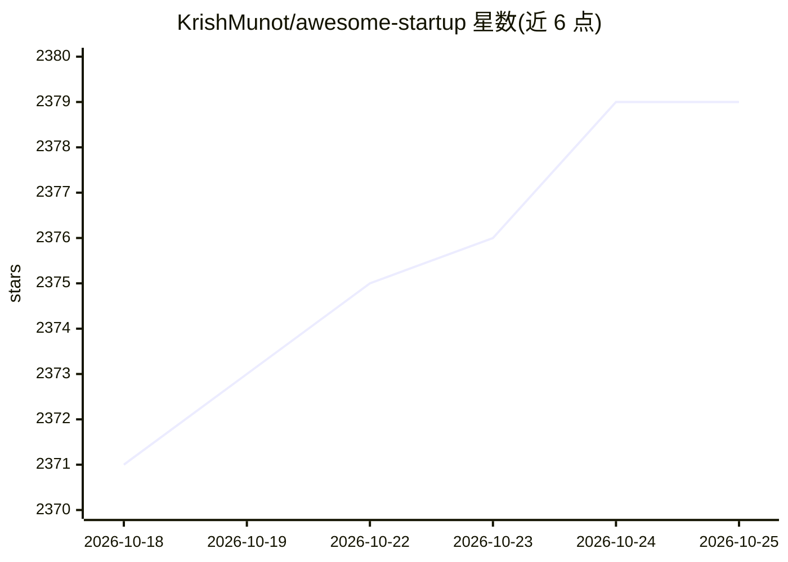

# KrishMunot/awesome-startup

⭐ 2,379 · MIT · 推送 2026-08-26 · [GitHub](https://github.com/KrishMunot/awesome-startup) · 个人维护

**创业者资源策展清单：书籍/课程/AI 工具一站式收录**

面向创始人的策展资源清单（awesome list），收录创业书籍、YC 课程与讲座、创始人随笔等基础阅读材料，并设『AI for Founders』板块：按日常工作助手、模型与 API 接入、Agent 开发工具（MCP、LangChain、LlamaIndex 等）、评测与可观测性、推理与向量数据基础设施分类罗列工具条目，每条附一句定位说明。纯清单形态，无安装与运行实体，仅供查阅选型。

## 筛选速览

| 维度 | 判定 | 备注 |
|---|---|---|
| AI 角色 | `ai-knowledge` | 知识聚合/清单类 |
| 许可风险 | `permissive` | MIT |
| 部署形态 | `None` |  |
| 模型依赖 | — | README 未给出锁定关系 |
| 硬件要求 | — | 无带数字的原话,不猜 |
| 安装摩擦 | `low` | 无编译、无系统依赖或容器化 |
| 成熟度 | — | 结构信号不足 |

## 能力要点

- 书籍/课程/随笔三类创业基础资源收录
- AI 板块按助手/模型接入/Agent/评测/推理五类组织
- 每条目附一句用途定位说明

## 适用场景

- 初创创始人系统性补齐创业阅读与课程
- 查找 LLM 产品开发所需工具链与评测方案
- 了解 AI 时代创业工具生态的组织方式

## 场景标签

`精选清单` · 领域:学习与行业

## 证据(README 行号)

> L6: A curated list of awesome books, videos, courses, tools and resources about making a startup.
> L87: The most consequential change to startup building since this list began. A small team can now ship what used to tak

## 星数曲线

2026-10-18 2,371 → 2026-10-25 2,379（+8）

---
*卡片 v1 · prompt 1.4 · 生成 2026-10-21 · 置信度 high · 依据 README sha `777b45e6cfab` · [字段定义](../../DATASET.md)*
