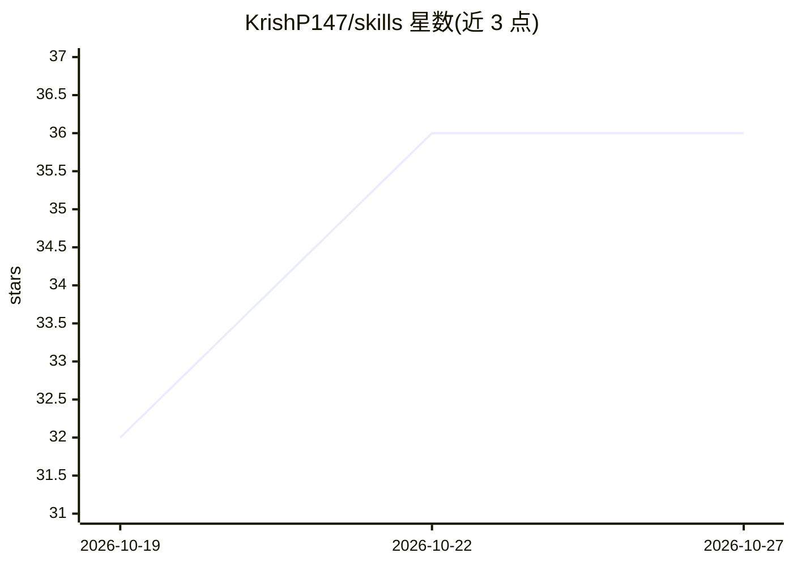

# KrishP147/skills

⭐ 36 · Python · MIT · 推送 2026-10-26 · [GitHub](https://github.com/KrishP147/skills) · [官网](https://www.krishpunjabi.com/skills) · 个人维护

**给开发者的 Claude Code 技能/子代理集合：规划、编排与多账号工作流**

个人维护的 Claude Code 配置仓库：29 个技能（SKILL.md 提示词）、4 个子代理与 3 个钩子。功能分四类：规划决策（grilling 追问、grill-docs 决策记录、wayfinder 大任务地图）、构建编排（pair 单任务隔离 worktree、meta-orchestrator 无人值守跑整个 backlog 并自带合并门禁、score-loop 自动刷分）、会话与账号（handoff 会话交接、switch 多账号切换、remind 提醒）、审阅报告（pr-watch 盯 PR、progress-report 生成报告）。通过插件市场或安装脚本安装，多数技能依赖 gh CLI，部分需 Python 3.8+。

## 筛选速览

| 维度 | 判定 | 备注 |
|---|---|---|
| AI 角色 | `ai-ecosystem` | LLM/agent 周边工具 |
| 许可风险 | `permissive` | MIT |
| 部署形态 | `desktop` | 安装包/桌面程序 |
| 模型依赖 | — | README 未给出锁定关系 |
| 硬件要求 | — | 无带数字的原话,不猜 |
| 安装摩擦 | `low` | 无编译、无系统依赖或容器化 |
| 成熟度 | — | 结构信号不足 |

## 能力要点

- meta-orchestrator 无人值守循环 planner→manager→verifier，测试与 CI 全绿才合并
- 三级工作模式：Solo 单步循环 / Pair 单任务 / Orchestrated 整个 backlog
- switch 多账号管理与用量提醒钩子
- grill-docs 将决策问答写入仓库文档供其他技能读取

## 适用场景

- 用 Claude Code 无人值守地处理一个仓库的整个任务积压
- 让 AI 追问并压力测试技术方案，留下决策记录
- 在多个 Claude Code 账号间切换并监控用量配额

## 场景标签

`提示工程` `编码 Agent` · 领域:Agent 开发

## 证据(README 行号)

> L7: A **skill** is a directory with a `SKILL.md` that Claude Code loads into the current conversation when it decides th
> L19: |Claude Code|runs every skill and agent here|`claude --version`|
> L47: |**Orchestrated**|`/meta-orchestrator <repo>`|one top-level session looping planner → manager → merge gate → verifi

## 星数曲线

2026-10-19 32 → 2026-10-27 36（+4）

---
*卡片 v1 · prompt 1.4 · 生成 2026-10-25 · 置信度 mid · 依据 README sha `307353814708` · [字段定义](../../DATASET.md)*
