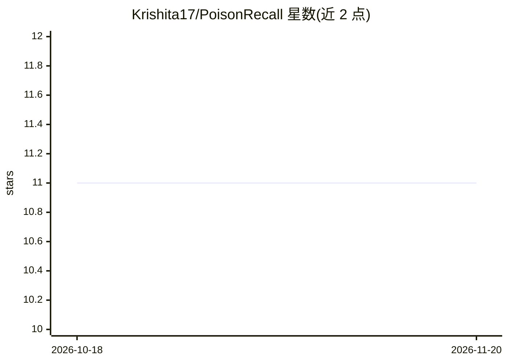

# Krishita17/PoisonRecall

⭐ 11 · Python · MIT · 推送 2026-09-23 · [GitHub](https://github.com/Krishita17/PoisonRecall) · 个人维护

**LLM agent 长期记忆投毒的攻击分类、工具与防御研究库**

面向 LLM agent 持久记忆（长期记忆存储与 RAG 向量库）投毒威胁的安全研究项目：实现一个可插拔 LLM 后端的模块化目标 agent，提供 8 种攻击（含对抗特定防御的自适应攻击与擦除型对手）与 6 种可组合防御（来源溯源、完整性签名、共识、异常检测、可认证鲁棒层、哈希链审计日志），并附带真实（SQuAD）与合成数据管线和可复现评估，make eval/figures 在无 API key 下重新生成全部图表。定位为防御性研究用途，MIT 许可。

## 筛选速览

| 维度 | 判定 | 备注 |
|---|---|---|
| AI 角色 | `ai-ecosystem` | LLM/agent 周边工具 |
| 许可风险 | `permissive` | MIT |
| 部署形态 | `library` | 以包/库形式分发 |
| 模型依赖 | local-ok | 支持本地模型 |
| 硬件要求 | — | 无带数字的原话,不猜 |
| 安装摩擦 | `low` | 无编译、无系统依赖或容器化 |
| 成熟度 | — | 结构信号不足 |

## 能力要点

- 8 种攻击 + 6 种可组合防御的攻防对照评估
- 认证鲁棒层：仅可信去重来源投票，附鲁棒半径证书
- 哈希链审计日志覆盖记忆擦除威胁
- 默认路径离线确定，无需 API key 即可复现全部图表

## 适用场景

- 研究 agent 记忆投毒攻击的机制与持续性
- 为 RAG/长期记忆系统组合并评估多层防御
- 复现并扩展 memory-poisoning 安全实验

## 场景标签

`网络安全` `模型评测` · 领域:评测与运维

## 证据(README 行号)

> L3: **Attack taxonomy, toolkit & defenses for persistent-memory poisoning of LLM agents.**
> L23: This repo builds **both sides** as an **attacker-vs-defender arms race**: a
> L237: |Backend|Enable|Config|

## 星数曲线

2026-10-18 11 → 2026-11-20 11（+0）

---
*卡片 v1 · prompt 1.4 · 生成 2026-11-19 · 置信度 mid · 依据 README sha `46fa4ff80964` · [字段定义](../../DATASET.md)*
