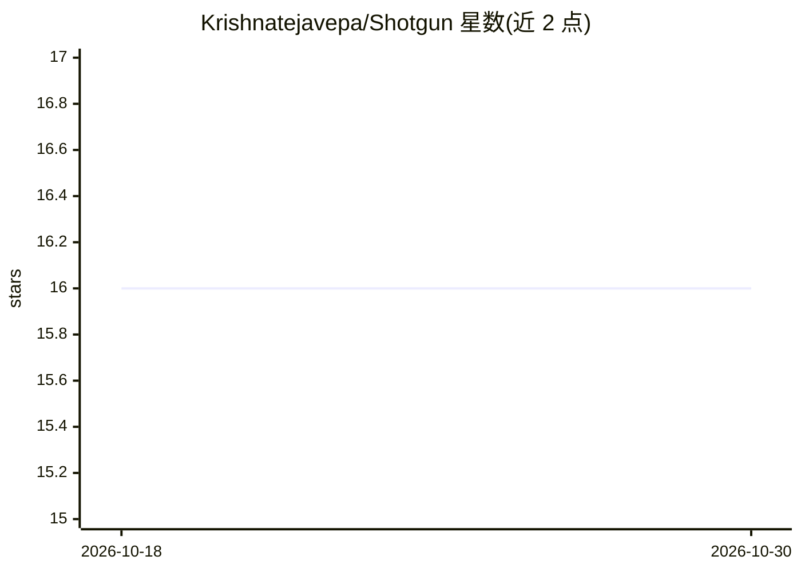

# Krishnatejavepa/Shotgun

⭐ 16 · Markdown · MIT · 推送 2026-07-12 · [GitHub](https://github.com/Krishnatejavepa/Shotgun) · 个人维护

**给独立创始人的 AI 联创操作系统：为任意 agent 注入记忆与执行循环**

通过 shotgun-init 向项目文件夹注入 SHOTGUN.md 操作循环、.shotgun/ 技能、记忆与数据仓库脚手架，把读取 AGENTS.md 标准的 AI agent（Claude Code、Cursor、Gemini CLI 等 20+ 工具）转变为面向独立创始人的联创：持久记忆、24 个工程技能、自主 act-verify-fix 循环、写作风格学习、增长实验与五人评审面板。全部为 markdown 与 git 文件，无服务器无数据库，仅在用户运行时执行。不依赖特定模型层级。

## 筛选速览

| 维度 | 判定 | 备注 |
|---|---|---|
| AI 角色 | `ai-ecosystem` | LLM/agent 周边工具 |
| 许可风险 | `permissive` | MIT |
| 部署形态 | `None` |  |
| 模型依赖 | locked-api |  |
| 硬件要求 | — | 无带数字的原话,不猜 |
| 安装摩擦 | `low` | 无编译、无系统依赖或容器化 |
| 成熟度 | — | 结构信号不足 |

## 能力要点

- 向项目注入操作循环、技能、记忆与数据仓库脚手架，不覆盖既有文件
- 兼容读取 AGENTS.md 标准的 20+ agent，并对 Claude Code/Cursor/Gemini CLI 等提供一等接入
- 自主循环：写循环契约，act–verify–fix 直到验证完成或给出阻塞报告
- 纯 markdown + git 存储，可导出整个联创为 bundle（排除密钥）

## 适用场景

- 独立创始人让 AI agent 持续记忆并推进产品、增长与运营
- 在 Claude Code 或 Cursor 等现有 agent 上叠加联创式工作流
- 把散落文件、CSV、笔记整理进可检索的数据仓库

## 场景标签

`工作流自动化` `AI 助手` `Agent 记忆` · 领域:Agent 开发

## 证据(README 行号)

> L28: This injects the full operating system into any project folder — the `SHOTGUN.md` loop, `.shotgun/` skills, memory 
> L68: Works on **any agent that reads the AGENTS.md standard** - Codex CLI, Windsurf, Zed, Devin, Aider, Amp, Jules, and 

## 星数曲线

2026-10-18 16 → 2026-10-30 16（+0）

---
*卡片 v1 · prompt 1.4 · 生成 2026-10-30 · 置信度 high · 依据 README sha `66f254484159` · [字段定义](../../DATASET.md)*
