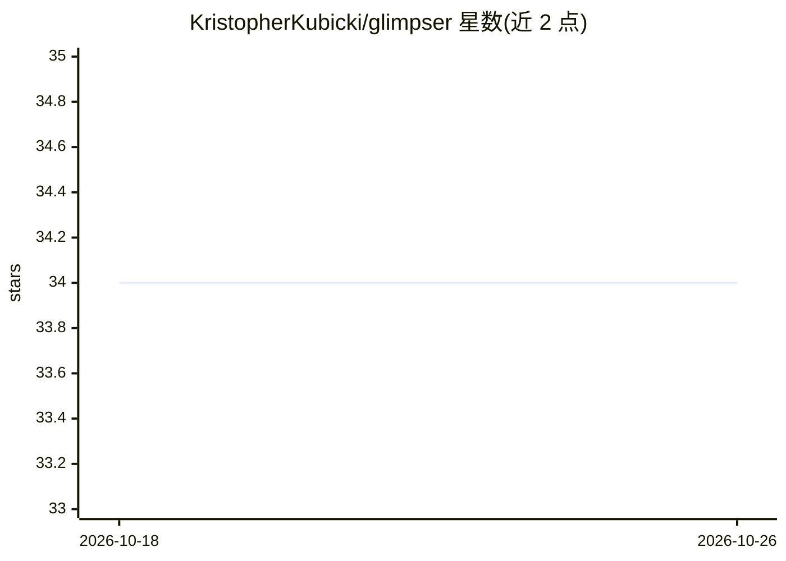

# KristopherKubicki/glimpser

⭐ 34 · Python · MIT · 推送 2026-10-20 · [GitHub](https://github.com/KristopherKubicki/glimpser) · [官网](https://glimpser.net) · 个人维护

**实时摄像头/视频流监控应用：采集、运动检测并生成 AI 摘要与警报**

Python 编写的实时监控应用，从 IP 摄像头、仪表盘和视频流等来源持续采集数据，提供图像对比变化检测、运动检测与警报、自动配文与多源数据 AI 摘要（集成 ChatGPT 类模型）。支持 RTSP/MJPEG 端点输出供外部 NVR 接入、本地网络摄像头发现（ONVIF/RTMP/HLS 等）、HTTP 回调 webhook、Twilio 短信警报、数据保留策略与数据库驱动的 Web 配置界面。安装提供 pip 包、源码与 Docker 方式，发布流水线产出 Debian 包及 Windows/macOS 二进制。

## 筛选速览

| 维度 | 判定 | 备注 |
|---|---|---|
| AI 角色 | `ai-enhanced` | 去掉 AI 部分产品仍成立 |
| 许可风险 | `permissive` | MIT |
| 部署形态 | `desktop` | 安装包/桌面程序 |
| 模型依赖 | — | README 未给出锁定关系 |
| 硬件要求 | — | 无带数字的原话,不猜 |
| 安装摩擦 | `low` | 无编译、无系统依赖或容器化 |
| 成熟度 | — | 结构信号不足 |

## 能力要点

- 多源实时采集与运动检测，触发警报与动作
- AI 自动配文与多源数据摘要（集成 ChatGPT 类模型）
- RTSP(/test.rtsp) 与 MJPEG(/test.mjpg) 端点供外部 NVR 接入
- 本地网络摄像头自动发现（ONVIF/RTSP/RTMP/HLS/SSDP）

## 适用场景

- 监控交通或天气摄像头并接收变化/运动警报
- 为摄像头画面生成 AI 配文与摘要以便快速了解内容
- 将 MJPEG 流作为基础摄像头源接入现有 NVR 软件

## 场景标签

`图像视频处理` · 领域:感知与多模态

## 证据(README 行号)

> L15: Glimpser is a straightforward yet powerful real-time monitoring application designed to capture, analyze, and summa
> L39: - **AI Integration**: Integrates with models like ChatGPT to provide intelligent insights. It can summarize data, d

## 星数曲线

2026-10-18 34 → 2026-10-26 34（+0）

---
*卡片 v1 · prompt 1.4 · 生成 2026-10-25 · 置信度 mid · 依据 README sha `1d81b52ac154` · [字段定义](../../DATASET.md)*
