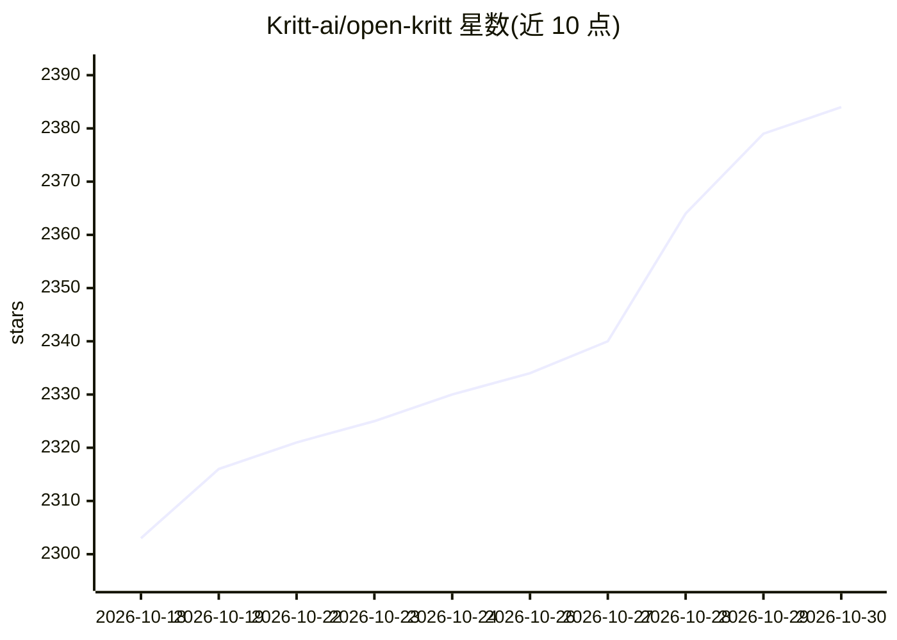

# Kritt-ai/open-kritt

⭐ 2,384 · JavaScript · AGPL-3.0 · 推送 2026-10-29 · [GitHub](https://github.com/Kritt-ai/open-kritt) · [官网](https://kritt.ai/) · 组织维护

**自托管 AI 安全研究平台：编排多 agent 在代码中查找并验证漏洞**

开源、自托管的安全与漏洞研究平台：将研究拆分为多个小任务并行分发给 AI agent（可用 Codex、Claude Code 或 Grok Build 运行扫描），将输出合并为去重、按严重度排序的发现，并支持后处理脚本验证问题、构建 PoC 与生成报告，结果以 ZIP 归档导出。面向希望自控提示词、工作流、模型提供方（OpenAI/Anthropic/DeepSeek/OpenRouter/xAI）与基础设施的安全研究员和开发者。通过 git clone 与 Docker Compose 部署，提供无头 CLI；agent 在一次性容器内以 root 运行，文档建议在专用 Docker 主机或 VM 上运行，后端本身不含应用鉴权。

## 筛选速览

| 维度 | 判定 | 备注 |
|---|---|---|
| AI 角色 | `ai-native` | 本体是模型或模型工具 |
| 许可风险 | `viral` | AGPL-3.0 |
| 部署形态 | `self-host` | docker 或自建部署 |
| 模型依赖 | locked-api |  |
| 硬件要求 | — | 无带数字的原话,不猜 |
| 安装摩擦 | `low` | 无编译、无系统依赖或容器化 |
| 成熟度 | — | 结构信号不足 |

## 能力要点

- 链式提示词构建可复用的安全研究工作流
- 发现自动去重、统一 schema 与自定义严重度排序
- 后处理脚本验证问题、构建 PoC 并打包导出 ZIP 归档
- 自带模型接入：Codex 登录或 OpenAI/Anthropic/DeepSeek/OpenRouter/xAI API

## 适用场景

- 对远程或本地仓库及其依赖做 AI 漏洞扫描
- 用自定义工作流和提示词组织安全研究
- 对发现的漏洞做验证、构建 PoC 并导出报告

## 场景标签

`网络安全` `多智能体` · 领域:Agent 开发

## 证据(README 行号)

> L5: **Orchestrate AI agents to find real vulnerabilities in code.**
> L7: An open-source, self-hosted security and vulnerability research platform that turns
> L8: focused AI analysis into de-duplicated, ranked findings with configurable validation and

## 星数曲线

2026-10-18 2,303 → 2026-10-30 2,384（+81）

---
*卡片 v1 · prompt 1.4 · 生成 2026-10-21 · 置信度 mid · 依据 README sha `2707b2988fcd` · [字段定义](../../DATASET.md)*
