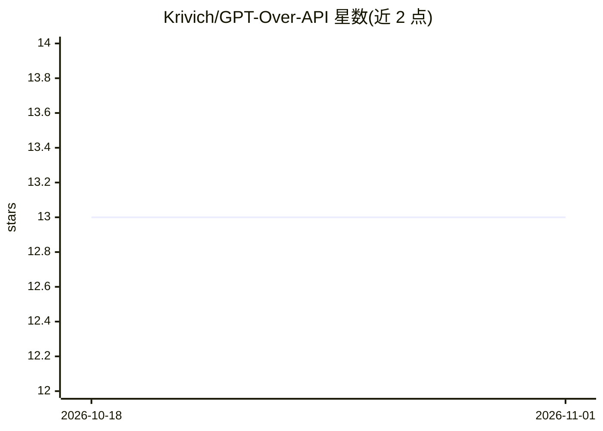

# Krivich/GPT-Over-API

⭐ 13 · HTML · Apache-2.0 · 推送 2026-01-13 · [GitHub](https://github.com/Krivich/GPT-Over-API) · [官网](https://krivich.github.io/GPT-Over-API/) · 个人维护

**单 HTML 文件的本地零服务器 LLM 聊天客户端**

一个自包含的单 HTML 文件聊天客户端，可连接任何 OpenAI 兼容 API 端点（OpenAI、OpenRouter、LMStudio、Ollama、vLLM 等），直接在浏览器中打开使用，无需服务器、账号与第三方依赖，API 密钥与对话记录保存在本地 localStorage。特色机制是用 TF-IDF 索引按相关性选取历史消息构建上下文，用户可通过复选框查看和修改实际发送的内容。面向最终用户与喜欢 tinkering 的开发者，README 明确声明这是实验性软件，超长对话（>1000 条）可能拖慢索引。

## 筛选速览

| 维度 | 判定 | 备注 |
|---|---|---|
| AI 角色 | `ai-native` | 本体是模型或模型工具 |
| 许可风险 | `permissive` | Apache-2.0 |
| 部署形态 | `library` | 以包/库形式分发 |
| 模型依赖 | local-ok | 支持本地模型 |
| 硬件要求 | — | 无带数字的原话,不猜 |
| 安装摩擦 | `low` | 无编译、无系统依赖或容器化 |
| 成熟度 | `idea` | |

## 能力要点

- 单 HTML 文件零依赖运行，无需服务器与安装
- TF-IDF 索引选取相关历史消息构建上下文，可视化并可手动调整
- 支持任何 OpenAI 兼容 API 端点，含本地与云端模型
- 多聊天历史保存于浏览器 localStorage，支持移动端与桌面端

## 适用场景

- 在浏览器本地直接与本地或云端 LLM 对话
- 透明控制发送给模型的上下文内容，避免泄露全部历史
- 在不搭建服务器的环境里快速使用自有 API key 聊天

## 场景标签

`聊天机器人` · 领域:对话与助手

## 证据(README 行号)

> L7: A **single HTML file** that lets you chat with any LLM that has an OpenAI-compatible API endpoint. No servers. No ac
> L22: - Connect to **any OpenAI-compatible API** (OpenAI, OpenRouter, LMStudio, Ollama, vLLM, etc.)

## 星数曲线

2026-10-18 13 → 2026-11-01 13（+0）

---
*卡片 v1 · prompt 1.4 · 生成 2026-10-31 · 置信度 high · 依据 README sha `b47ea9a2ca5e` · [字段定义](../../DATASET.md)*
