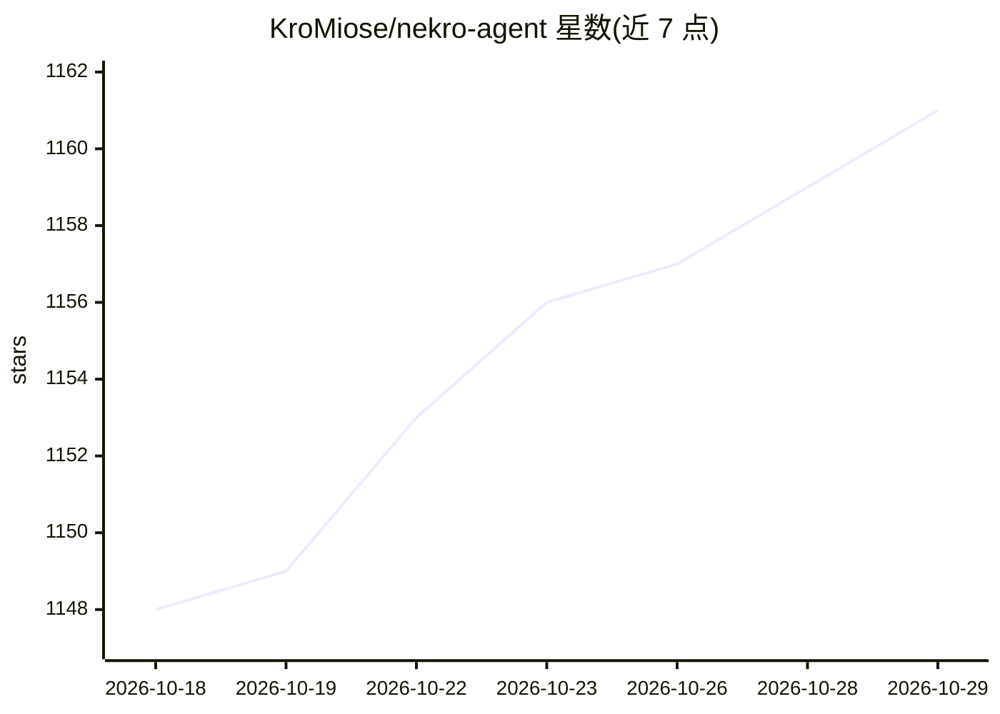

# KroMiose/nekro-agent

⭐ 1,161 · Python · NOASSERTION · 推送 2026-10-09 · [GitHub](https://github.com/KroMiose/nekro-agent) · [官网](https://nekro.ai) · 个人维护 · 中文 README

**多平台 AI 聊天与代理执行 Bot 框架，供群聊场景部署**

NekroAgent 是面向多人互动场景的 Python Agent 框架：通过提示词系统引导大模型生成代码并在容器化沙盒中执行，经 RPC 与环境交互，实现工具调用与复杂任务处理。支持 QQ(OneBot v11)、Discord、Telegram、Minecraft、B站直播、微信、邮件、SSE+SDK 等平台接入，提供插件系统、长期记忆、结构化 MCP 管理、定时任务与 WebUI 可视化控制台。提供 docker-compose 一键部署与一键安装脚本，Docker 镜像分 latest/preview 标签发布；许可为基于 Apache 2.0 修改的自定义协议。工作区、记忆系统等标注为预览版特性。

## 筛选速览

| 维度 | 判定 | 备注 |
|---|---|---|
| AI 角色 | `ai-native` | 本体是模型或模型工具 |
| 许可风险 | `none` | NOASSERTION |
| 部署形态 | `self-host` | docker 或自建部署 |
| 模型依赖 | — | README 未给出锁定关系 |
| 硬件要求 | — | 无带数字的原话,不猜 |
| 安装摩擦 | `low` | 无编译、无系统依赖或容器化 |
| 成熟度 | `idea` | |

## 能力要点

- AI 生成代码并在安全容器化沙盒中执行，经 RPC 与真实环境交互
- 8 类平台适配器（QQ/Discord/Telegram/Minecraft/B站直播/微信/邮件/SSE+SDK）
- 插件系统与云端插件、人设市场共享
- 长期记忆（向量检索）、结构化 MCP 管理、WebUI 可视化控制台（预览版）

## 适用场景

- 在 QQ/Discord 等群聊平台部署具备代码执行能力的 AI 聊天 Bot
- 通过人设系统与长期记忆构建情感陪伴或生活助手
- 基于插件与沙盒扩展为自动化任务处理 Agent

## 场景标签

`Agent 框架` `聊天机器人` · 领域:Agent 开发

## 证据(README 行号)

> L44: NekroAgent 通过强大灵活的提示词构建系统，引导 AI 生成准确的代码并在沙盒中执行，通过 RPC 通信来与真实环境交互。主要特点包括：
> L56: - **多平台适配器架构**：原生支持 `OneBot v11` (QQ)、`Discord`、`Telegram`、`Minecraft`、`B站直播`、`微信`、`邮件` 及 `SSE+SDK` 等多种聊天平台，提供统一的开发

## 星数曲线

2026-10-18 1,148 → 2026-10-29 1,161（+13）

---
*卡片 v1 · prompt 1.4 · 生成 2026-10-21 · 置信度 high · 依据 README sha `76a81d823057` · [字段定义](../../DATASET.md)*
