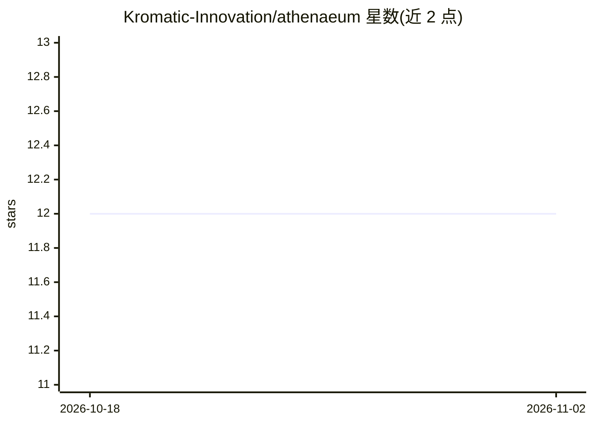

# Kromatic-Innovation/athenaeum

⭐ 12 · Python · Apache-2.0 · 推送 2026-11-01 · [GitHub](https://github.com/Kromatic-Innovation/athenaeum) · [官网](https://kromatic.com) · 组织维护

**面向 AI agent 的跨会话记忆层：追加式写入、单一编译器生成结构化 wiki**

独立于单次会话的记忆管线：agent 通过 remember 工具向只追加的 intake 日志写入观察，后台编译器（librarian，默认夜间批处理）将原始流去重编译为带来源的实体 wiki，sidecar 在每轮自动注入相关片段。冲突按九级来源优先级解决，无法解决的进入人工决策队列；每条 claim 携带来源，git 快照可回滚。存储为磁盘 markdown，单写者锁与每轮 API 预算限制。提供方仅支持 Anthropic API 与 claude CLI 两种后端，无 OpenAI/本地模型后端；单所有者非多租户。以 pip 包提供，含 MCP 工具与 CLI。

## 筛选速览

| 维度 | 判定 | 备注 |
|---|---|---|
| AI 角色 | `ai-ecosystem` | LLM/agent 周边工具 |
| 许可风险 | `permissive` | Apache-2.0 |
| 部署形态 | `library` | 以包/库形式分发 |
| 模型依赖 | locked-api |  |
| 硬件要求 | — | 无带数字的原话,不猜 |
| 安装摩擦 | `low` | 无编译、无系统依赖或容器化 |
| 成熟度 | `idea` | |

## 能力要点

- 只追加 intake + 单一 librarian 编译器生成去重 wiki
- 九级来源优先级冲突解决与人工决策队列
- sidecar 每轮自动注入相关 wiki 片段，无需工具调用
- 单写者锁与每轮硬性 API 预算限制

## 适用场景

- 知识量超出 agent 原生记忆容量的长期项目记忆管理
- 需要追溯每条事实来源、防止低权威数据覆盖高权威数据
- 多个 agent 或人机共同写入同一知识库

## 场景标签

`Agent 记忆` · 领域:Agent 开发

## 证据(README 行号)

> L19: Athenaeum is a memory layer that sits outside any one agent session. Agents **write**
> L21: that raw stream into a structured, deduplicated **wiki** of entities. A **sidecar** injects
> L83: That gives your agent two tools: `remember` to write an observation, `recall` to search

## 星数曲线

2026-10-18 12 → 2026-11-02 12（+0）

---
*卡片 v1 · prompt 1.4 · 生成 2026-11-01 · 置信度 high · 依据 README sha `ebb3b565ea68` · [字段定义](../../DATASET.md)*
