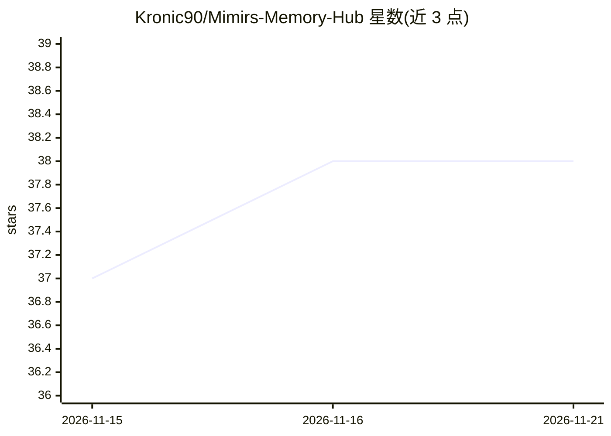

# Kronic90/Mimirs-Memory-Hub

⭐ 38 · Python · NOASSERTION · 推送 2026-11-17 · [GitHub](https://github.com/Kronic90/Mimirs-Memory-Hub) · [官网](https://kronic90.github.io/Mimirs-Memory-Hub/) · 个人维护

**本地 AI 陪伴/角色平台：跨会话持久拟人记忆**

面向终端用户的免费本地 AI 陪伴与角色平台，在用户自己的 PC 上运行（无显卡的普通笔记本亦可）。核心机制是模拟人类记忆：情绪标记（42 标签分类器）、重要性评分、神经递质调制、遗忘曲线衰减、'睡眠'巩固周期（Huginn/Muninn/Völva 三阶段），检索采用 BM25+语义嵌入+扩散激活的混合方式。支持 10 种 LLM 后端（Ollama、GGUF/llama.cpp、vLLM、OpenAI、Anthropic 等），可导入 SillyTavern/Character.ai 角色卡与聊天记录；支持图像与语音输入、多角色群聊，另提供可选的 Agent 模式（21 个工具、MCP）。Windows 提供免安装便携包（内置 Python），macOS/Linux 需看安装章节；README 列出基准数据（LongMemEval Recall@5 93.9%）并声明较弱类别见 BENCHMARKS.md。

## 筛选速览

| 维度 | 判定 | 备注 |
|---|---|---|
| AI 角色 | `ai-native` | 本体是模型或模型工具 |
| 许可风险 | `none` | NOASSERTION |
| 部署形态 | `desktop` | 安装包/桌面程序 |
| 模型依赖 | local-ok | 支持本地模型 |
| 硬件要求 | — | 无带数字的原话,不猜 |
| 安装摩擦 | `low` | 无编译、无系统依赖或容器化 |
| 成熟度 | — | 结构信号不足 |

## 能力要点

- 持久记忆：情绪权重、遗忘曲线衰减、召回增强稳定度、闪光灯记忆不衰减
- '睡眠'巩固周期：合并近重复、剪枝、跨主题梦境式综合
- 10 种 LLM 后端（Ollama/GGUF/llama.cpp/vLLM/OpenAI/Anthropic/OpenRouter 等）
- 导入 SillyTavern / Chub / TavernAI 角色卡及 Character.ai 角色+聊天记录
- 语音（Gemma 4 直接听音、Whisper 转写）与图像视觉输入

## 适用场景

- 在本地与有长期记忆的 AI 角色持续对话，不依赖云端
- 把 SillyTavern 或 Character.ai 的角色和聊天历史迁移过来
- 通过记忆浏览器与 8 种可视化查看、编辑角色记忆
- 切换到 Agent/Assistant 预设使用 21 个可选工具与 MCP 做助手任务

## 场景标签

`聊天机器人` `Agent 记忆` · 领域:Agent 开发

## 证据(README 行号)

> L11: Mimir's Memory Hub is a free AI companion and character platform that runs on your own PC — **even a laptop with no
> L98: |🖥️ **10 LLM backends**|Ollama, Local GGUF, Transformers/SafeTensors (GPU), OpenAI, Anthropic, Google, OpenRouter, 

## 星数曲线

2026-11-15 37 → 2026-11-21 38（+1）

---
*卡片 v1 · prompt 1.4 · 生成 2026-11-18 · 置信度 high · 依据 README sha `4ba32245eeec` · [字段定义](../../DATASET.md)*
