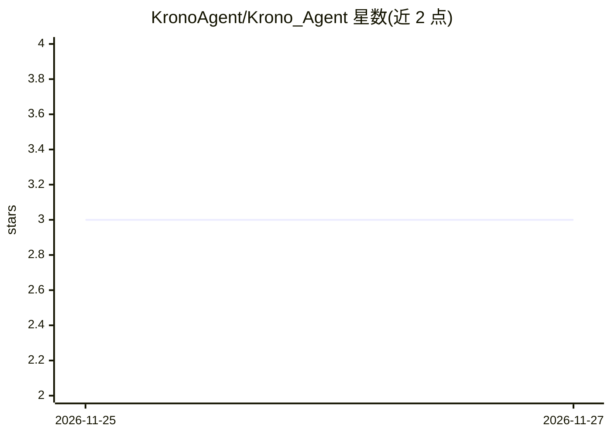

# KronoAgent/Krono_Agent

⭐ 3 · C# · MIT · 推送 2026-11-26 · [GitHub](https://github.com/KronoAgent/Krono_Agent) · [官网](https://kronoagent.github.io/Krono_Agent/) · 个人维护

**Windows 原生 AI agent 工作台，集成本地模型与工具调用**

基于 C# / WinUI 3 的原生 Windows agent 工作台，聊天、项目、设置、Markdown 与游戏均用 XAML 控件，仅内嵌浏览器用 WebView2；agent 在私有本地 Node worker 上通过 stdio 运行，无 Electron 宿主与本地 HTTP 控制服务。支持在设置中配置模型提供商的 API key 或连接 Ollama / LM Studio / Jan 等 OpenAI 兼容本地服务器，工具调用需模型支持。账号服务依赖自建 Supabase 项目，macOS/Linux 桌面界面未实现。

## 筛选速览

| 维度 | 判定 | 备注 |
|---|---|---|
| AI 角色 | `ai-native` | 本体是模型或模型工具 |
| 许可风险 | `permissive` | MIT |
| 部署形态 | `desktop` | 安装包/桌面程序 |
| 模型依赖 | local-ok | 支持本地模型 |
| 硬件要求 | — | 无带数字的原话,不猜 |
| 安装摩擦 | `medium` | 含编译或系统依赖之一 |
| 成熟度 | `idea` | |

## 能力要点

- 原生 WinUI 3 应用，仅 WebView2 用于内嵌浏览器
- agent 经 stdio 在本地 Node worker 运行，无 Electron 与 localhost HTTP 服务
- 支持 Ollama、LM Studio、Jan 及 OpenAI 兼容服务器的本地模型发现
- 计划任务、账号同步、权限分级与文件附件（≤4 个、每个 64 KB）

## 适用场景

- 在 Windows 桌面用本地 Ollama/LM Studio 模型运行 agent
- 管理带项目文件工具与权限审批的 agent 会话
- 用计划任务在窗口驻留托盘时定时执行对话任务

## 场景标签

`AI 助手` · 领域:对话与助手

## 证据(README 行号)

> L3: Native Windows agent workspace built with C# / WinUI 3. Chat, projects, settings,
> L58: - In Settings, choose a model provider, save its API key locally, test the connection, and select a model. For Olla
> L60: - In Chat mode, the agent has no tools. Ask permissions request approval for changes and commands. Project permissi

## 星数曲线

2026-11-25 3 → 2026-11-27 3（+0）

---
*卡片 v1 · prompt 1.4 · 生成 2026-11-24 · 置信度 high · 依据 README sha `8bb46a33c4ef` · [字段定义](../../DATASET.md)*
