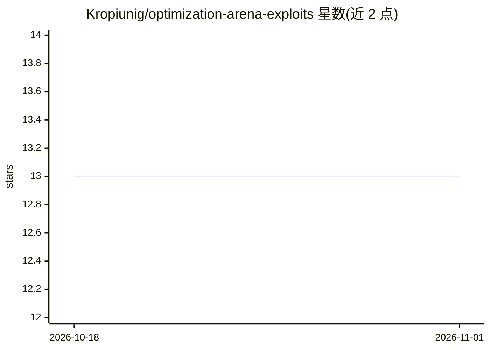

# Kropiunig/optimization-arena-exploits

⭐ 13 · Python · 推送 2026-04-10 · [GitHub](https://github.com/Kropiunig/optimization-arena-exploits) · 个人维护

**黑客松榜单逆向攻略：复现谈判与预测市场挑战的高分策略**

作者在 Paradigm + Meridian 黑客松 Optimization Arena 两个 LLM 挑战中冲入前十后的复盘仓库。核心方法：通过公开 API 抓取排行榜选手的完整对局记录，从中提取获胜模式。谈判挑战给出两个利用方案（拖延至第 4 轮、伪造谈判历史的提示注入，95-100% 分）；预测市场挑战给出锚定初始中间价的做市策略（+$282 mean edge），并指出评分指标与真实 P&L 的偏差及随机种子彩票效应。仓库仅含策略文本、一个 Python 策略文件与榜单截图，无安装流程。

## 筛选速览

| 维度 | 判定 | 备注 |
|---|---|---|
| AI 角色 | `ai-knowledge` | 知识聚合/清单类 |
| 许可风险 | `none` | — |
| 部署形态 | `None` |  |
| 模型依赖 | — | README 未给出锁定关系 |
| 硬件要求 | — | 无带数字的原话,不猜 |
| 安装摩擦 | `low` | 无编译、无系统依赖或容器化 |
| 成熟度 | — | 结构信号不足 |

## 能力要点

- 从排行榜公开 API 抓取对局记录逆向获胜策略
- 谈判挑战两个利用：拖延战术（~84%）与伪造历史提示注入（95-100%）
- 预测市场：锚定初始中间价做市策略，mean edge 从 -$7 到 +$282
- 指出 meanEdge 指标与真实 P&L 脱节及多次提交的种子运气效应

## 适用场景

- 参加 Optimization Arena 类黑客松时参考高分策略
- 研究 LLM 谈判 agent 的提示注入攻击面
- 了解竞赛评分指标与真实收益偏差的案例

## 场景标签

 · 领域:AI 竞赛/agent 安全

## 证据(README 行号)

> L3: **How I scored top 10 in the negotiation challenge and tied at the $323.34 leaderboard cap in the prediction market 
> L30: Challenge link · Score = mean of 10 games. Each game splits a pool of `books`, `hats`, `balls` with hidden valuatio

## 星数曲线

2026-10-18 13 → 2026-11-01 13（+0）

---
*卡片 v1 · prompt 1.4 · 生成 2026-10-31 · 置信度 mid · 依据 README sha `dae4ada96e06` · [字段定义](../../DATASET.md)*
