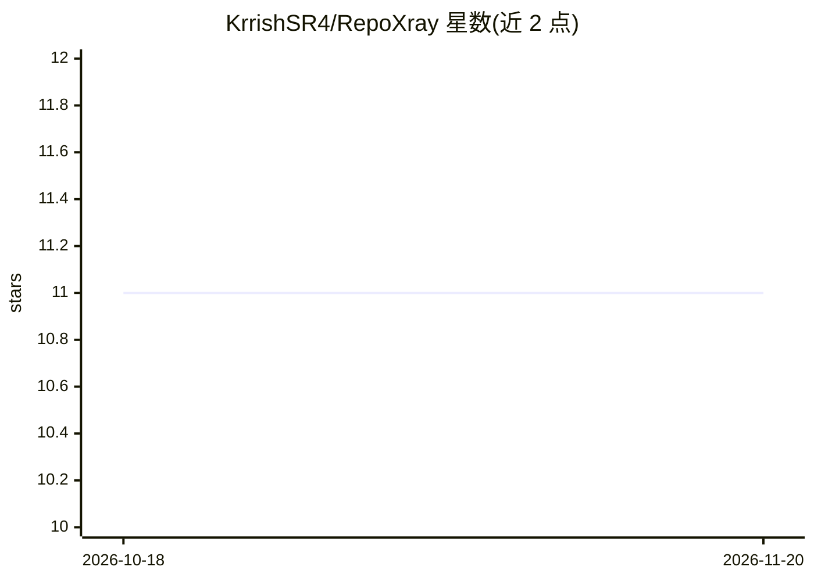

# KrrishSR4/RepoXray

⭐ 11 · TypeScript · MIT · 推送 2026-10-07 · [GitHub](https://github.com/KrrishSR4/RepoXray) · [官网](https://repoxray.web.app/) · 个人维护

**面向开发者与学生解析 GitHub 仓库结构的 AI 工具**

用户粘贴 GitHub 仓库 URL 后，该 Web 应用生成结构化解释、逐文件拆解、洞察信息与入门学习路径；Developer Mode 另提供 Profile Analyzer、Repo Score、README Generator 与 SEO Optimizer。安装方式为 git clone 源码后 npm install 并 npm run dev 启动。README 未说明底层模型与 API key 配置方式，DevSecOps 项标注为规划中。

## 筛选速览

| 维度 | 判定 | 备注 |
|---|---|---|
| AI 角色 | `ai-native` | 本体是模型或模型工具 |
| 许可风险 | `permissive` | MIT |
| 部署形态 | `library` | 以包/库形式分发 |
| 模型依赖 | — | README 未给出锁定关系 |
| 硬件要求 | — | 无带数字的原话,不猜 |
| 安装摩擦 | `low` | 无编译、无系统依赖或容器化 |
| 成熟度 | — | 结构信号不足 |

## 能力要点

- 粘贴仓库 URL 即生成结构化解释与逐文件拆解
- 提供入门学习路径（Start-Here Path）
- Developer Mode 含 Profile Analyzer、Repo Score、README Generator、SEO Optimizer
- Snippet Mode 与 Developer Mode 两种预览界面

## 适用场景

- 学生学习开源项目时快速了解仓库结构
- 开发者探索陌生代码库
- 团队评审外部项目
- 初学者理解代码库

## 场景标签

 · 领域:开发者工具/代码理解

## 证据(README 行号)

> L7: **RepoXray** is an AI-powered developer tool that helps you **understand any GitHub repository like a senior develop
> L9: Paste a repo → get:
> L32: * Repository Analysis

## 星数曲线

2026-10-18 11 → 2026-11-20 11（+0）

---
*卡片 v1 · prompt 1.4 · 生成 2026-11-19 · 置信度 mid · 依据 README sha `6427e137a2d3` · [字段定义](../../DATASET.md)*
