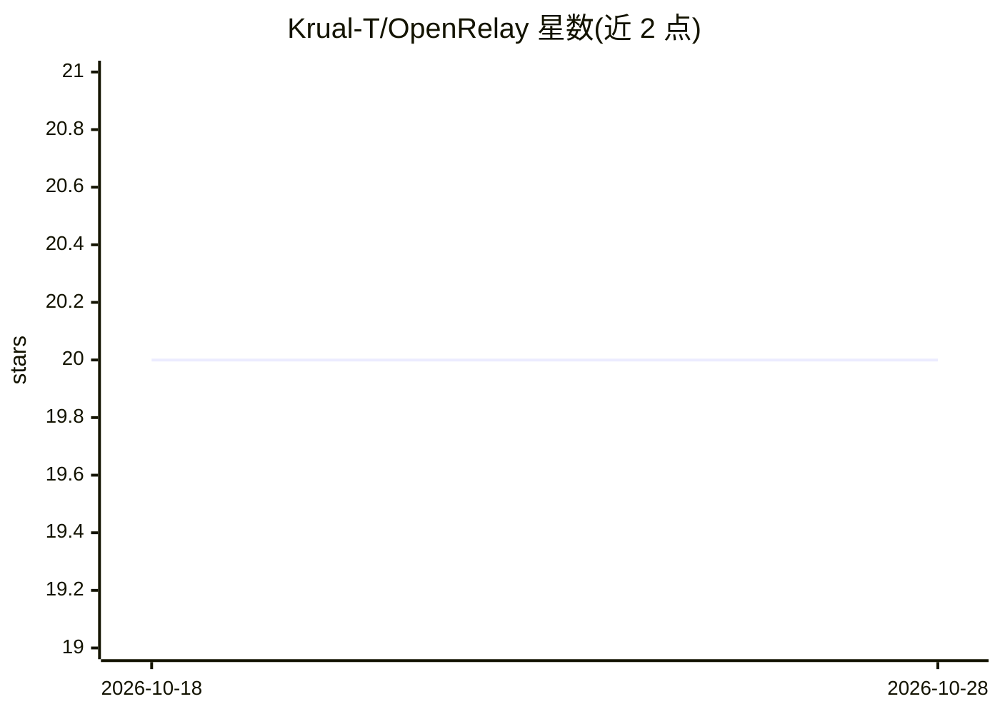

# Krual-T/OpenRelay

⭐ 20 · Python · 推送 2026-05-08 · [GitHub](https://github.com/Krual-T/OpenRelay) · 个人维护 · 中文 README

**把本地 Codex coding agent 接进飞书远程操控的工具**

面向已在本地定制 Codex 的开发者，将其以远程控制面板方式接入飞书：通过 codex app-server 续接真实 backend session，Feishu thread 与本地 agent session 绑定，支持线程内连续追问、流式卡片回复、/workspace 按目录切换项目上下文并复用各项目已有的 Codex 定义与 skills。分层架构（feishu/runtime/agent_runtime/backends/storage），SQLite 存储本地状态。Claude 适配器为最小实现，安装步骤在 INSTALL.md。

## 筛选速览

| 维度 | 判定 | 备注 |
|---|---|---|
| AI 角色 | `ai-ecosystem` | LLM/agent 周边工具 |
| 许可风险 | `none` | — |
| 部署形态 | `None` |  |
| 模型依赖 | — | README 未给出锁定关系 |
| 硬件要求 | — | 无带数字的原话,不猜 |
| 安装摩擦 | `low` | 无编译、无系统依赖或容器化 |
| 成熟度 | `idea` | |

## 能力要点

- 通过 codex app-server 续接原生 backend session，Feishu thread 绑定
- 按目录切换项目上下文，复用各项目已有 Codex 定义与 skills
- 流式卡片回复、follow-up 合并、命令分流、SQLite 状态存储
- backend-neutral runtime，含 Claude 最小适配器

## 适用场景

- 在飞书里远程驱动本机已调好的 Codex agent
- 多个项目目录各自保留独立 agent 定义并随时切换
- 长任务在线程内持续补充指令并追踪流式输出

## 场景标签

`编码 Agent` · 领域:编码与开发

## 证据(README 行号)

> L5: 让 `Codex` 真正以“远程工作台”的方式进入飞书：保留原生 session、支持 thread 内连续追问、可按目录切换不同项目上下文，并把流式执行过程稳定投影回聊天界面。
> L29: - 直接续接真实 backend thread，而不是伪造“上下文连续”
> L126: 4. `backends/`：Codex、Claude 等 provider adapter

## 星数曲线

2026-10-18 20 → 2026-10-28 20（+0）

---
*卡片 v1 · prompt 1.4 · 生成 2026-10-28 · 置信度 high · 依据 README sha `3d6d90d05578` · [字段定义](../../DATASET.md)*
