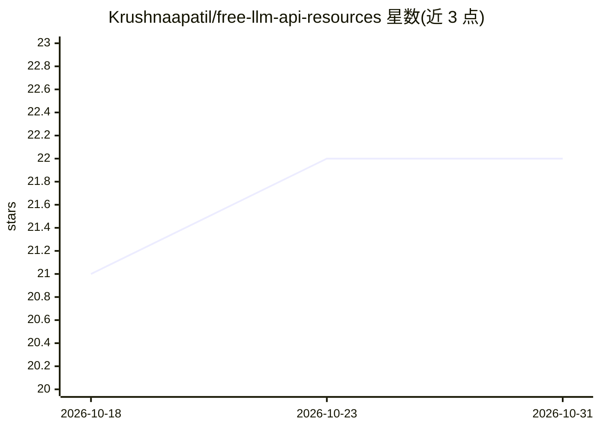

# Krushnaapatil/free-llm-api-resources

⭐ 22 · Python · 推送 2026-05-21 · [GitHub](https://github.com/Krushnaapatil/free-llm-api-resources) · 个人维护

**免费/试用额度 LLM API 服务商策展清单**

收录提供免费额度或试用积分的 API 式 LLM 服务商的策展清单，面向需要在测试、原型开发中寻找合规托管模型选项的开发者。按『免费服务商』与『试用积分服务商』两类组织，逐家列出速率/额度限制（如 OpenRouter 20 请求/分钟、Cloudflare Workers AI 10,000 neurons/天）、注意事项（电话验证、数据用于训练）及可用模型清单。明确排除逆向工程等非正规渠道，本清单为纯文档，无可安装组件。

## 筛选速览

| 维度 | 判定 | 备注 |
|---|---|---|
| AI 角色 | `ai-knowledge` | 知识聚合/清单类 |
| 许可风险 | `none` | — |
| 部署形态 | `None` |  |
| 模型依赖 | — | README 未给出锁定关系 |
| 硬件要求 | — | 无带数字的原话,不猜 |
| 安装摩擦 | `low` | 无编译、无系统依赖或容器化 |
| 成熟度 | — | 结构信号不足 |

## 能力要点

- 覆盖 OpenRouter、Google AI Studio、Groq、Cerebras 等十余家免费层服务商
- 记录每家的速率/令牌限额与验证、数据训练等限制条件
- 另列 Fireworks、Baseten 等试用积分服务商及额度（$0.5–$30 不等）
- 明确排除逆向工程聊天机器人的非正规服务

## 适用场景

- 为原型开发挑选有免费额度的 LLM API 服务商
- 对比各家免费层的速率与 token 限额
- 查找含试用积分的新兴推理服务商

## 场景标签

`精选清单` · 领域:学习与行业

## 证据(README 行号)

> L3: This lists various services that provide free access or credits towards API-based LLM usage.
> L13: ## Free Providers

## 星数曲线

2026-10-18 21 → 2026-10-31 22（+1）

---
*卡片 v1 · prompt 1.4 · 生成 2026-10-27 · 置信度 high · 依据 README sha `f657b559353f` · [字段定义](../../DATASET.md)*
