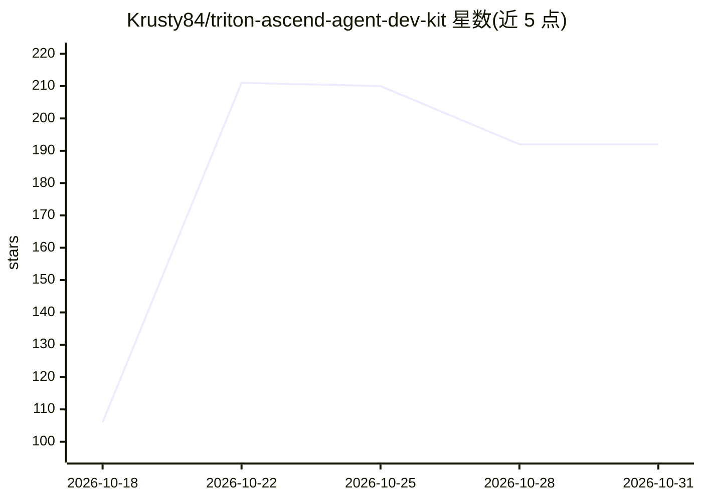

# Krusty84/triton-ascend-agent-dev-kit

⭐ 192 · Shell · Apache-2.0 · 推送 2026-08-15 · [GitHub](https://github.com/Krusty84/triton-ascend-agent-dev-kit) · [官网](https://www.hiascend.com/en/document) · 个人维护 · 中文 README

**供 AI agent 开发 Triton-Ascend NPU 内核的开发工具包**

面向 AI agent（如 Claude Code、Codex、OpenCode 类工具）的开发资料包：为 agent 提供在 Triton-Ascend 方言下编写内核、供昇腾 NPU 执行所需的上下文资源，并列出昇腾官方文档、triton-ascend 仓库与示例内核/算子库等参考链接。README 提示 Triton-Ascend 与 NPU 处于持续演进中，agent 生成的建议可能不适用于用户的具体环境。安装方式为从 Releases 获取归档，或运行 build 脚本自行构建，再解包到 agent 工作目录。

## 筛选速览

| 维度 | 判定 | 备注 |
|---|---|---|
| AI 角色 | `ai-ecosystem` | LLM/agent 周边工具 |
| 许可风险 | `permissive` | Apache-2.0 |
| 部署形态 | `None` |  |
| 模型依赖 | — | README 未给出锁定关系 |
| 硬件要求 | — | 无带数字的原话,不猜 |
| 安装摩擦 | `low` | 无编译、无系统依赖或容器化 |
| 成熟度 | — | 结构信号不足 |

## 能力要点

- 面向 AI agent 的 Triton-Ascend 内核开发资料包
- 附昇腾官方文档、triton-ascend 文档与内核/算子示例仓库链接
- 提供构建脚本生成 agent 专用归档

## 适用场景

- 让 AI agent 辅助编写 Triton-Ascend 内核
- 为 agent 工作目录补充昇腾 NPU 开发上下文
- 查找 Triton-Ascend 参考内核与算子实现

## 场景标签

 · 领域:AI 开发工具/异构计算

## 证据(README 行号)

> L5: This package is for your AI agent, which will try to help you develop kernels in the Triton-Ascend dialect for subse
> L29: - Or, run the `build-workspace-agent-specific-kit.sh` script, and then take the required archive from the `dist/` f

## 星数曲线

2026-10-18 106 → 2026-10-31 192（+86）

---
*卡片 v1 · prompt 1.4 · 生成 2026-10-22 · 置信度 mid · 依据 README sha `cf844cd8a54e` · [字段定义](../../DATASET.md)*
