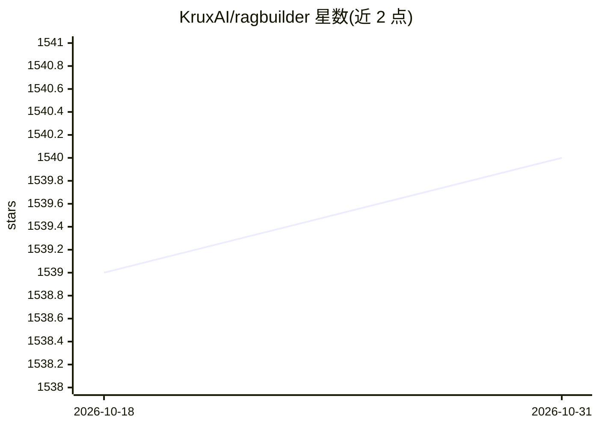

# KruxAI/ragbuilder

⭐ 1,540 · Python · Apache-2.0 · 推送 2026-10-02 · [GitHub](https://github.com/KruxAI/ragbuilder) · [官网](https://ragbuilder.pages.dev) · 组织维护

**自动调优并生成生产级 RAG 管线的 Python 工具包**

面向开发者的 RAG 构建工具包：对分块策略、检索器、reranker 等 RAG 参数做贝叶斯超参调优，在测试数据集上评估各配置以找出最优组合，也提供预定义模板；支持自定义评估指标、项目保存加载及以 API 服务形式部署。组件覆盖多种文档加载器、分块器、检索器（含需 Neo4j 的图检索）与 reranker。要求 Python 3.10+，可经 Docker Compose 部署。README 顶部声明该项目已停止积极维护，仅作参考保留；默认启用基本遥测，可通过环境变量关闭。

## 筛选速览

| 维度 | 判定 | 备注 |
|---|---|---|
| AI 角色 | `ai-ecosystem` | LLM/agent 周边工具 |
| 许可风险 | `permissive` | Apache-2.0 |
| 部署形态 | `self-host` | docker 或自建部署 |
| 模型依赖 | — | README 未给出锁定关系 |
| 硬件要求 | — | 无带数字的原话,不猜 |
| 安装摩擦 | `low` | 无编译、无系统依赖或容器化 |
| 成熟度 | — | 结构信号不足 |

## 能力要点

- 对 RAG 参数（分块策略/大小、检索器、reranker 等）做贝叶斯超参调优
- 支持合成测试数据集或自带数据集评估配置
- 可部署为 API 服务并保存/加载优化后的管线
- 支持自定义文档加载器、分块器、检索器与 reranker（custom_class）

## 适用场景

- 为自己的数据自动寻找最优 RAG 配置组合
- 用预定义模板快速搭建生产级 RAG 管线
- 将优化后的 RAG 管线以 API 服务形式提供查询

## 场景标签

`RAG` · 领域:知识与检索

## 证据(README 行号)

> L15: RagBuilder is a toolkit that helps you create optimal Production-ready Retrieval-Augmented-Generation (RAG) setup f
> L19: - **Hyperparameter Tuning**: Efficiently optimize your RAG configurations using Bayesian optimization

## 星数曲线

2026-10-18 1,539 → 2026-10-31 1,540（+1）

---
*卡片 v1 · prompt 1.4 · 生成 2026-10-21 · 置信度 high · 依据 README sha `1ad35ab48983` · [字段定义](../../DATASET.md)*
