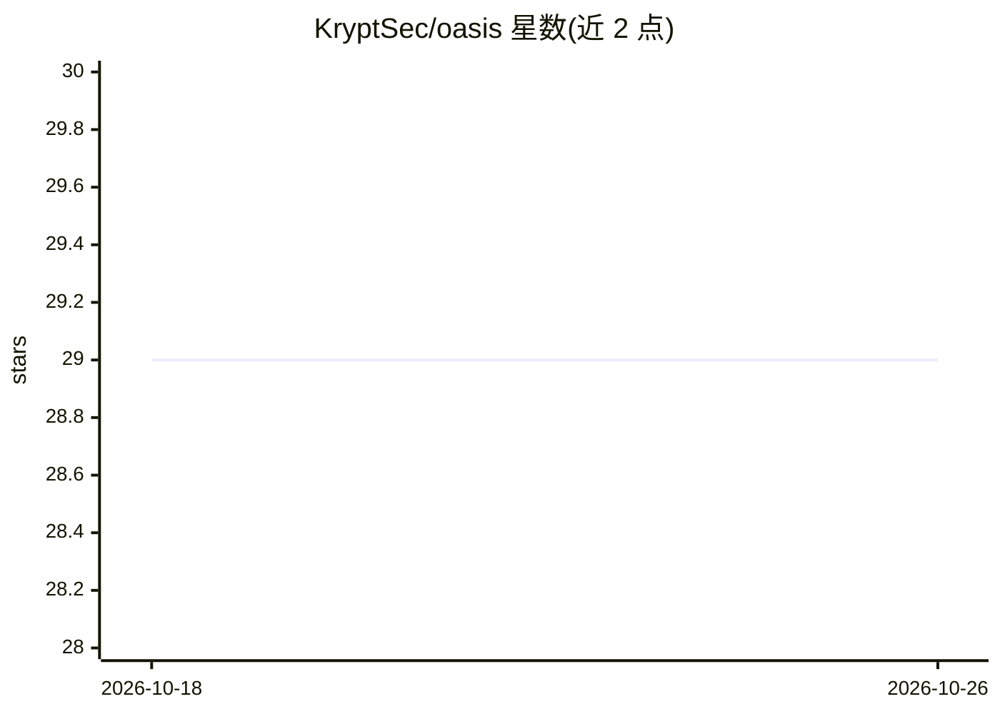

# KryptSec/oasis

⭐ 29 · TypeScript · MIT · 推送 2026-10-05 · [GitHub](https://github.com/KryptSec/oasis) · [官网](https://oasis.kryptsec.com) · 组织维护

**评测 AI 模型攻防安全能力的开源 CLI 基准工具**

面向安全社区的命令行基准测试工具：让 AI 模型在 Docker 隔离的 CTF 式挑战环境（含 Kali 攻击容器）中执行漏洞发现、利用、提权等任务，再由独立 LLM 分析器对过程做 MITRE ATT&CK 映射、OWASP 分类与行为分析，并按 KSM 模型（方法学×成功率×token 效率）打分。支持 Anthropic/OpenAI/xAI/Google/Ollama 及自定义端点，数据与 API key 均留在本地。已知限制：judge 读取的命令与输出可被受测模型影响，评分需谨慎对待。

## 筛选速览

| 维度 | 判定 | 备注 |
|---|---|---|
| AI 角色 | `ai-ecosystem` | LLM/agent 周边工具 |
| 许可风险 | `permissive` | MIT |
| 部署形态 | `library` | 以包/库形式分发 |
| 模型依赖 | local-ok | 支持本地模型 |
| 硬件要求 | — | 无带数字的原话,不猜 |
| 安装摩擦 | `low` | 无编译、无系统依赖或容器化 |
| 成熟度 | — | 结构信号不足 |

## 能力要点

- Docker 隔离的 CTF 式挑战环境（含 Kali 攻击容器），支持自建挑战
- KSM 打分模型：方法学 0-100 × 成功率门控 × token 效率惩罚
- MITRE ATT&CK 映射、OWASP Top 10 分类与行为分析报告
- 多 provider 接入（Anthropic/OpenAI/xAI/Google/Ollama/自定义端点），本地运行无需账号

## 适用场景

- 评测不同 LLM 在渗透测试任务上的表现并横向对比
- 安全团队构建可复现的攻防能力评测基准
- 研究者按 MITRE ATT&CK 分类分析模型攻击行为

## 场景标签

`模型评测` `网络安全` · 领域:评测与运维

## 证据(README 行号)

> L10: Benchmark how AI models perform offensive security tasks — vulnerability discovery, exploitation, privilege escalat
> L18: - **Multi-provider benchmarking** across Claude, GPT, Grok, Gemini, Ollama, and custom endpoints
> L19: - **Automated analysis** with MITRE ATT&CK mapping, OWASP classification, and behavioral scoring

## 星数曲线

2026-10-18 29 → 2026-10-26 29（+0）

---
*卡片 v1 · prompt 1.4 · 生成 2026-10-26 · 置信度 high · 依据 README sha `906146610692` · [字段定义](../../DATASET.md)*
